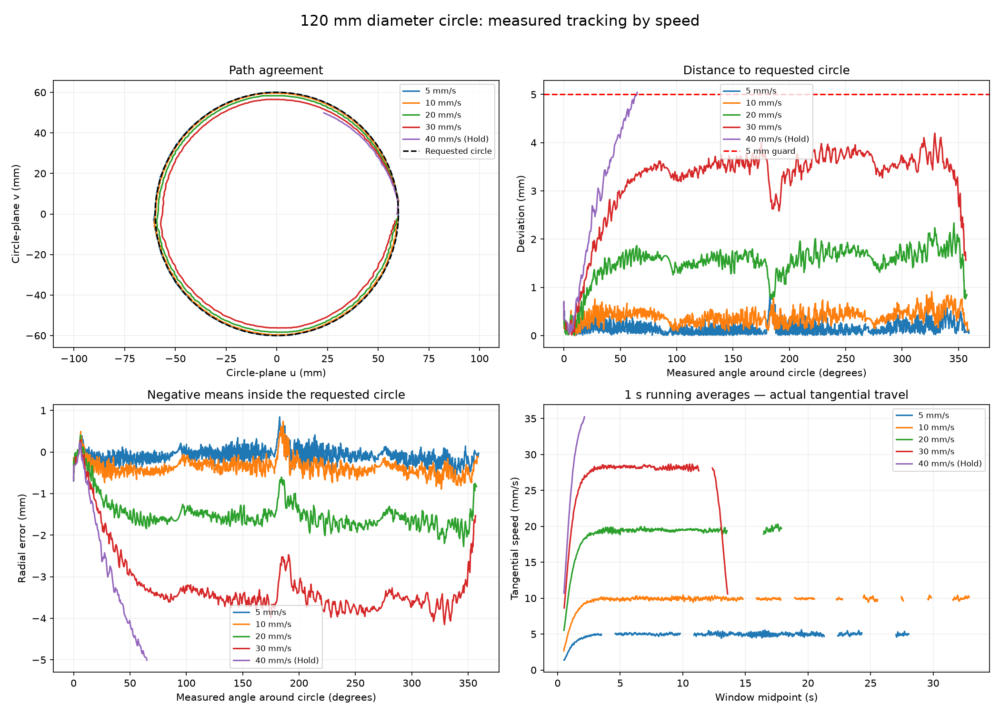

# Circular position–speed tracking: velocity and millimetre deviation

The user requested a kinematically feasible circle, repeated at different speeds, with TCP path agreement and deviation plots. **A 120 mm diameter vertical circle completed at 5, 10, 20 and 30 mm/s. At 40 mm/s the 5 mm edge guard stopped motion after 2.655 s.** Higher live feeds were skipped. Motors are disabled at verified rest.

## Selected circle and kinematic checks

- Radius **60 mm**, circumference **376.991 mm**, plane **YZ**, normal **+X**.
- Center in robot-base coordinates: **(260.211, 8.743, 268.775) mm**. Starts at **(260.211, 8.743, 328.775) mm**, initially travelling toward −Y. TCP orientation is unconstrained.
- Seed offset from captured rest: **[0, 0.20, 0.25, 0.10, 0, 0] rad**. Saved gripper command remains fixed.
- The candidate search found a passing circle immediately; this is a demonstrated local solution, not a claim of globally maximal radius or workspace coverage.
- Full seeded SDK IK, dense interpolated joint bounds/self-collision checks, reference velocity/acceleration/jerk checks, approach and rest-return checks passed. Maximum planned rest-relative excursion is **0.408 rad**; maximum joint span is **0.448 rad**. The normal **0.49 rad** automatic bound remained active throughout. No larger-excursion exception was used.
- Speed preflight passed 5/10/20/30/40/50/60/80 mm/s. The current planner rejected 100 mm/s with “Edge is too short to reach this feed within acceleration/jerk limits” after ramp expansion; this is a planner rejection, not a proof that no circular trajectory can achieve that feed.

[STEP circle](assets/circle.step) · [Geometry and seed](circle.json) · [Preflight](preflight.json) · [Search record](search.json)

## Measured tracking

| Requested speed (mm/s) | Outcome | Maximum online edge distance (mm) | RMS aligned edge distance (mm) | Max timed position error (mm) |
|---:|---|---:|---:|---:|
| 5 | Completed | 0.862 | 0.190 | 4.230 |
| 10 | Completed | 0.911 | 0.409 | 7.844 |
| 20 | Completed | 2.335 | 1.505 | 15.140 |
| 30 | Completed | 4.189 | 3.171 | 21.470 |
| 40 | Hold at 2.655 s | 5.060 | 2.631 | 26.739 |

**The circle shrinks inward as commanded speed increases.** At 30 mm/s, radial deviation reaches **−4.150 mm** while out-of-plane deviation stays below **0.761 mm**. At the 40 mm/s stop, the aligned trace reaches **−5.005 mm radial error**; the online total circle distance is **5.060 mm**. This is a measurable encoder/FK path distortion, not merely noise in instantaneous reported velocity.

The stop was caused by finite-circle distance. Orientation was unconstrained; the orientation number included in the generic stop message did not cause the Hold. Timed Euclidean error was recorded but did not stop motion. The 50/60/80 mm/s runs were skipped after the 40 mm/s guard; 100 mm/s was already rejected by preflight.

“Completed” means the full reference revolution plus the existing one-second final hold completed within the 5 mm circle-distance criterion. It does not mean zero endpoint/phase error: observed angular travel by the final trace sample was approximately 359.33°, 358.76°, 357.49° and 356.57° at 5/10/20/30 mm/s. The interrupted 40 mm/s trace covers only 65.05° of measured angular travel.

No run satisfies the unchanged all-samples raw ±20% feed criterion, so these results do not qualify Stage 3 globally. No SDK communication, oscillation or execution-watchdog fault occurred.



## Circle speed and nine averaging windows

Every recorded speed has nine running-average panels: **0.2, 0.3, 0.4, 0.5, 0.6, 0.7, 0.8, 0.9 and 1.0 s**. Actual and commanded averages use identical time intervals. The latest valid cruise-window value is labelled when no valid window exists at the planned cruise end; interrupted trials are explicitly labelled.

| Command (mm/s) | Latest valid 1 s actual tangential average (mm/s) | Window end (s) | Planned cruise end (s) |
|---:|---:|---:|---:|
| 5 | 4.984 | 28.553 | 75.398 |
| 10 | 10.116 | 33.364 | 37.699 |
| 20 | 19.693 | 18.378 | 18.850 |
| 30 | 27.739 | 11.783 | 12.566 |
| 40 | 35.235 | 2.655 | 9.425 |

These values are **latest valid observed windows**, not all final cruise averages. In particular, the last valid 1 s window at 5 mm/s ends at 28.553 s during a much longer run. Feedback skew over 10 ms invalidates 392 snapshots at 5 mm/s, 44 at 10 mm/s, 11 at 20 mm/s and one at 30 mm/s; the 30 mm/s trace also has one repeated feedback snapshot. Three inter-snapshot gaps exceed 50 ms in the 5 mm/s trace. No snapshot has feedback age above 50 ms. Windows that overlap these intervals are omitted rather than filled or extrapolated. The longer averaging charts consequently contain visible gaps.

Actual tangential travel is accumulated as **∫ρ dθ**, using measured radius ρ and unwrapped measured angle θ. This avoids two errors: dividing a long chord by time understates speed around a curve, while multiplying angular rate by the *nominal* radius overstates actual tangential speed when the arm cuts inside the circle. Signed increments avoid rectifying small encoder jitter into extra travel. Radial and out-of-plane motion are reported separately; the velocity label explicitly says *tangential* rather than total 3D speed.

Joint positions and raw velocities are aligned to common feedback times before SDK FK/Jacobian evaluation. Gray curves retain the raw actuator velocity with its previously documented quantization/bias; SDK guard feedback is unchanged. Trailing averages are plotted at window midpoints and become available half a window later. Two new analytical tests verify full-circle unwrapping/arc velocity and a shrunken circle with independent plane error; all five circle/window tests passed.

These are model/encoder estimates of the configured TCP. No external TCP metrology, applied-force test, or mechanical stiffness/compliance measurement was performed. “Path agreement” in these plots means adherence to the commanded geometry. The data show geometric lag/distortion and speed behaviour; they do not identify a unique physical cause.

## Individual plots

Each tracking figure includes the 3D TCP path, planar requested/measured overlay, distance to the circle in mm, signed radial/out-of-plane errors in mm, timed XYZ/Euclidean error in mm, and selected running speed averages.

- **5 mm/s:** [Tracking and millimetre errors](plots/circle60-5mms-tracking.png) · [All nine velocity windows](plots/circle60-5mms-windows.png)
- **10 mm/s:** [Tracking and millimetre errors](plots/circle60-10mms-tracking.png) · [All nine velocity windows](plots/circle60-10mms-windows.png)
- **20 mm/s:** [Tracking and millimetre errors](plots/circle60-20mms-tracking.png) · [All nine velocity windows](plots/circle60-20mms-windows.png)
- **30 mm/s:** [Tracking and millimetre errors](plots/circle60-30mms-tracking.png) · [All nine velocity windows](plots/circle60-30mms-windows.png)
- **40 mm/s:** [Tracking and millimetre errors](plots/circle60-40mms-tracking.png) · [All nine velocity windows](plots/circle60-40mms-windows.png) — interrupted.

[All numeric plot metrics](plots/metrics.json). Each recorded run has its original `.jsonl` trace, `.json` plan/result and `-control.jsonl` SDK telemetry in this directory. Skipped runs retain their reasons.

## Final state and reproduction

Normal return and one-second rest verification completed with **0.153° maximum joint error**. Motors are disabled; POS_VEL remains selected. The temporary per-joint speed ceiling is restored to **0.15 rad/s** and the automatic excursion bound remains **0.49 rad**. Saved rest/gripper, motion limits, MIT gains, gravity configuration and friction-off state match the pre-run snapshot. No onboard gains, ACC/DEC, TIMEOUT or Flash values were changed. The camera remained available without a manual camera gate.

Ruff passes for all new files; five focused hardware-free tests pass. No production controller/SDK code was changed for this experiment. Plot generation and tests ran with motors disabled.

Offline plot reproduction:

```bash
MPLCONFIGDIR=/tmp/autoweld-mpl .venv/bin/python -m scripts.plot_circle_speed
```

[Validation](validation.json) · [Final rest status](final-rest-status.json) · [Offline preflight script](../../scripts/circle_preflight.py) · [Recorded live runner](../../scripts/circle_speed_suite.py) · [Plotting script](../../scripts/plot_circle_speed.py)
