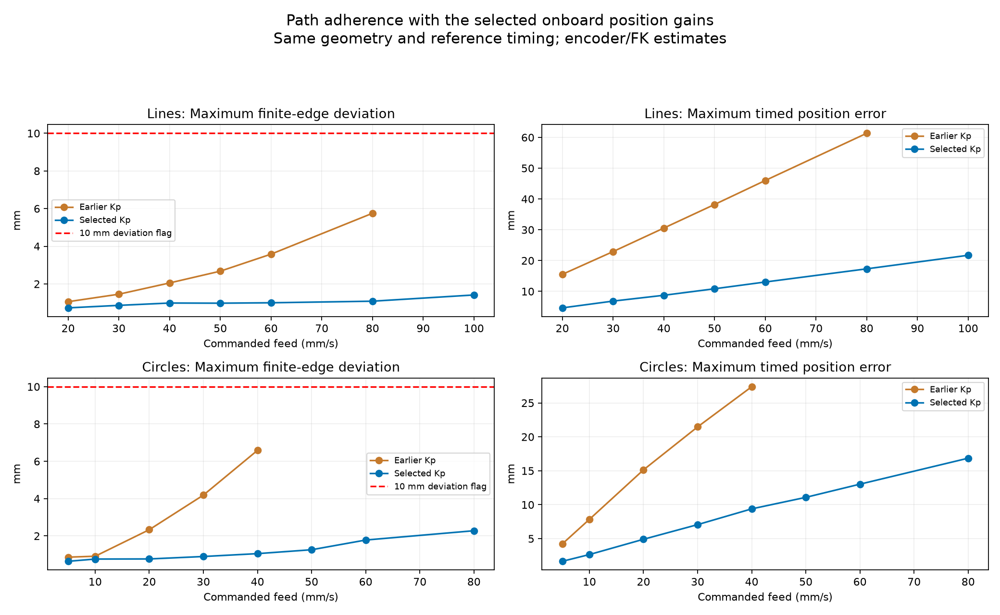
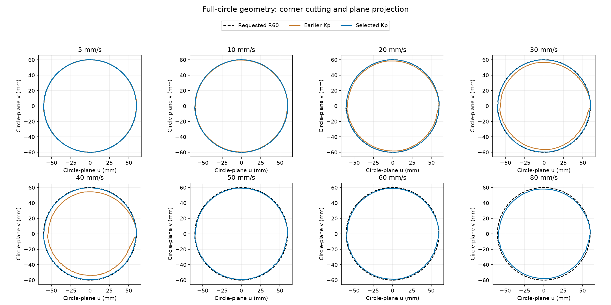

# Larger path repeat with selected onboard gains — 2026-09-21

All **15 accepted paths completed**: seven 500 mm lines at 20–100 mm/s and eight R60 mm full circles at 5–80 mm/s. Every completed path stayed below the 10 mm reporting threshold. Worst peak finite-edge deviation was **1.414 mm for lines** and **2.279 mm for circles**. No SDK communication, oscillation or execution-watchdog fault occurred. The 100 mm/s circle was rejected offline and was not commanded.

The selected gains substantially reduce both geometric error and timed lag on these fixtures. Matched line peak error improved 31–81%; matched circle peak error improved 17–84%. Timed position error fell 70–72% on the matched lines and 61–68% on circles. These are historical single-run comparisons at identical geometry, feed and reference duration, not randomized repeatability or global welding qualification.

## Configuration and scope

Onboard RAM `KP_APR` J1–J6: `[193.4917603, 193.4917603, 193.4917603, 54, 77.7600021, 64.8000031]`. Independent SDK surveys and every enable confirmed the selected gains. All surveyed actuator registers, Flash, host gains, motion limits, saved rest/gripper record, gravity settings and friction-off state were preserved. Gains remain RAM-only. The current overshoot criteria remain 0.1° for J1–J3 and 0.5° for J4–J6; this path experiment does not independently requalify directed waypoint overshoot at every pose.

The line runs from approximately `(265.160, −241.067, 282.395)` to `(265.160, 258.933, 282.395)` mm. The full circle has R60 mm, center `(260.211, 8.743, 268.775)` mm, and normal along X. Both use unconstrained orientation and ramps inside the edge. These runs do **not** qualify welding-normal orientation. The selected safe presets remain **20 mm/s lines, 10 mm/s circles/arcs**.

The repeat renewed the existing 1.55 rad exception only for the same reviewed 500 mm line; it was restored to 0.49 rad before circles. Speed ceilings ranged from 0.15 to 0.5 rad/s as preflighted and were restored to 0.15 before each normal rest return. Joint/collision/derivative checks, SDK fault gates, the 100 ms watchdog and the full one-second oscillation guard stayed active. Path deviations would have been recorded without stopping.

## Path adherence in millimetres

Finite-edge error is distance to the requested geometric edge. Timed error includes along-path lag relative to the scheduled reference and is a different quantity. Values below use the entire standard reference-plus-one-second trace, including ramps. RMS is time-weighted. All are encoder/FK estimates, not external TCP metrology or force compliance.

### 500 mm line

| Feed mm/s | Peak edge, before mm | Peak edge, new mm | RMS edge, new mm | Peak timed error, before mm | Peak timed error, new mm |
|---:|---:|---:|---:|---:|---:|
| 20 | 1.056 | 0.729 | 0.218 | 15.530 | 4.643 |
| 30 | 1.454 | 0.861 | 0.242 | 22.920 | 6.843 |
| 40 | 2.051 | 0.985 | 0.290 | 30.552 | 8.730 |
| 50 | 2.678 | 0.977 | 0.290 | 38.212 | 10.845 |
| 60 | 3.581 | 0.999 | 0.332 | 46.009 | 13.043 |
| 80 | 5.752 | 1.083 | 0.418 | 61.343 | 17.318 |
| 100 | — | 1.414 | 0.563 | — | 21.724 |

[All lines error-versus-time comparisons](plots/lines-comparison.png)

### R60 mm circle

| Feed mm/s | Peak edge, before mm | Peak edge, new mm | RMS edge, new mm | Peak timed error, before mm | Peak timed error, new mm |
|---:|---:|---:|---:|---:|---:|
| 5 | 0.862 | 0.640 | 0.139 | 4.230 | 1.665 |
| 10 | 0.911 | 0.760 | 0.151 | 7.844 | 2.658 |
| 20 | 2.335 | 0.766 | 0.195 | 15.140 | 4.910 |
| 30 | 4.189 | 0.897 | 0.301 | 21.470 | 7.069 |
| 40 | 6.588 | 1.051 | 0.467 | 27.390 | 9.392 |
| 50 | — | 1.260 | 0.695 | — | 11.087 |
| 60 | — | 1.780 | 0.954 | — | 13.031 |
| 80 | — | 2.279 | 1.506 | — | 16.856 |

[All circles error-versus-time comparisons](plots/circles-comparison.png)

There is no earlier completed baseline for line 100 or circle 50/60/80 mm/s. Older complete traces had the historical 5 mm stop policy except line 80 and circle 40, whose complete baselines use the later reporting-only policy. No interrupted baseline is silently compared against a full new trace.

### Circle geometry

Corner cutting remains speed-dependent. At 40 mm/s, the new minimum radial error is −1.031 mm; at 80 mm/s it is −2.266 mm, with at most 0.582 mm out-of-plane error. The highest-speed circle is therefore still smaller than the requested circle during cruise.

[Radial and out-of-plane error plots](plots/circles-components.png) use signed millimetres; negative radial values mean inside the requested circle.

| Circle feed mm/s | Minimum radial error mm | Maximum radial error mm | Maximum absolute plane error mm |
|---:|---:|---:|---:|
| 5 | -0.399 | 0.631 | 0.162 |
| 10 | -0.499 | 0.753 | 0.149 |
| 20 | -0.573 | 0.752 | 0.190 |
| 30 | -0.690 | 0.873 | 0.204 |
| 40 | -1.031 | 0.575 | 0.238 |
| 50 | -1.248 | 0.429 | 0.337 |
| 60 | -1.751 | 0.353 | 0.427 |
| 80 | -2.266 | 0.314 | 0.582 |

## Velocity: nine full windows, 0.2–1.0 seconds

Each run has raw velocity and nine running-average plots, with the latest valid cruise average explicitly marked. Averages use actual encoder displacement over each full time window; circle displacement integrates measured radius times angular travel. Commands are averaged over the identical interval. Samples are aligned using per-joint encoder timestamps; invalid timing windows are omitted, not interpolated into passing evidence. See [METHOD.md](METHOD.md) for thresholds.

Every **valid** one-second cruise window is inside ±20% for these 15 runs. Median measured one-second speeds closely match the command, but invalid coverage prevents that statement from applying to the complete trace. In particular, only 339/3670 eligible windows (9.2%) remain valid on the 5 mm/s circle. The exact final cruise average is shown below only when that entire window is valid. “Latest valid” annotations in figures may occur earlier.

| Run | Median valid 1 s cruise avg mm/s | Valid / eligible 1 s windows | Exact final cruise 1 s avg mm/s |
|---|---:|---:|---:|
| line500-20mms | 20.00 | 623 / 1169 | — |
| line500-30mms | 29.99 | 595 / 754 | 30.267 |
| line500-40mms | 39.98 | 266 / 547 | — |
| line500-50mms | 49.99 | 196 / 418 | 49.833 |
| line500-60mms | 59.95 | 188 / 333 | 60.064 |
| line500-80mms | 79.90 | 162 / 224 | — |
| line500-100mms | 99.73 | 82 / 157 | — |
| circle60-5mms | 4.98 | 339 / 3670 | — |
| circle60-10mms | 10.01 | 506 / 1800 | — |
| circle60-20mms | 19.99 | 438 / 863 | 19.753 |
| circle60-30mms | 29.86 | 379 / 550 | 29.998 |
| circle60-40mms | 39.74 | 185 / 392 | 39.945 |
| circle60-50mms | 49.24 | 105 / 296 | — |
| circle60-60mms | 58.80 | 163 / 231 | 58.979 |
| circle60-80mms | 77.55 | 95 / 129 | — |

No run meets the complete existing raw-speed/sampling qualification. The 80 mm/s line has a maximum valid raw-speed error of 18.10% but two invalid velocity samples, so it remains unqualified. Larger windows smooth encoder noise and reveal average cruise performance; they do not demonstrate instantaneous speed, acceleration or jerk compliance. The 100 mm/s line still has 21.724 mm maximum timed error, despite 1.414 mm geometric deviation.

## Endpoint settling, interruption and final state

After the standard trace, each completed run recorded roughly three more seconds holding the endpoint. Final target errors ranged from 0.058 to 0.169 mm. See [settling-metrics.json](settling-metrics.json) and each `-settling-control.jsonl` archive. Endpoint precision after stopping does not establish precision throughout motion.

The first 80 mm/s circle attempt timed out waiting for `track_approach`: planning took 5.749 s, exceeding the recorder’s 5 s inbox wait. The approach was accepted late and completed; **no circle reference was sent in that attempt**. Fresh status was reconciled, then normal verified-rest disable succeeded. The recorder now waits up to 30 s only for planning replies (`track_approach` / `track_run`); this changes no SDK motion watchdog. Tests verify a delayed reply produces one request, and an unanswered request still fails without resubmission. The second attempt completed. Both the error and full approach/recovery telemetry are retained, including `circle60-80mms-attempt1-complete-control.jsonl`.

Final normal rest verification: **0.02186° maximum joint error**. Independent read-back confirms **all seven actuators disabled**, all surveyed registers unchanged and selected RAM gains retained. Speed cap 0.15 rad/s and automatic bound 0.49 rad are restored. Viewer on port 8081 is running disabled with Position–speed selected; its start-disabled pose display is cached, not live motor feedback. No stage is marked DONE.

Validation: **209 hardware-free tests passed; Ruff passed.** Plots were generated only with motors disabled. Representative summary, geometry, tracking and velocity panels were visually inspected.

## Complete evidence and plot index

- [Manifest and historical baselines](manifest.json), [all 16 preflight outcomes](preflight.json), [method](METHOD.md).
- [Comparison metrics, including all nine windows and exact final-window validity](comparison.json), [online results and latest-valid averages](metrics.json), [settling](settling-metrics.json).
- [Initial registers](registers-initial.json), [final registers](registers-final.json), [settings audit](settings-validation.json), [final verified rest](final-rest-status.json), [final viewer](final-viewer-status.json).
- [Tests](tests.log), [Ruff](ruff.log), [line acquisition log](lines.log), [circle acquisition log with timeout](circles.log), [successful circle retry](circles-retry.log).

| Run | Full tracking plot | Nine velocity windows | Raw trace |
|---|---|---|---|
| line500-20mms | [Tracking](plots/line500-20mms-attempt1-tracking.png) | [0.2–1.0 s](plots/line500-20mms-attempt1-windows.png) | [JSONL](line500-20mms-attempt1.jsonl) |
| line500-30mms | [Tracking](plots/line500-30mms-attempt1-tracking.png) | [0.2–1.0 s](plots/line500-30mms-attempt1-windows.png) | [JSONL](line500-30mms-attempt1.jsonl) |
| line500-40mms | [Tracking](plots/line500-40mms-attempt1-tracking.png) | [0.2–1.0 s](plots/line500-40mms-attempt1-windows.png) | [JSONL](line500-40mms-attempt1.jsonl) |
| line500-50mms | [Tracking](plots/line500-50mms-attempt1-tracking.png) | [0.2–1.0 s](plots/line500-50mms-attempt1-windows.png) | [JSONL](line500-50mms-attempt1.jsonl) |
| line500-60mms | [Tracking](plots/line500-60mms-attempt1-tracking.png) | [0.2–1.0 s](plots/line500-60mms-attempt1-windows.png) | [JSONL](line500-60mms-attempt1.jsonl) |
| line500-80mms | [Tracking](plots/line500-80mms-attempt1-tracking.png) | [0.2–1.0 s](plots/line500-80mms-attempt1-windows.png) | [JSONL](line500-80mms-attempt1.jsonl) |
| line500-100mms | [Tracking](plots/line500-100mms-attempt1-tracking.png) | [0.2–1.0 s](plots/line500-100mms-attempt1-windows.png) | [JSONL](line500-100mms-attempt1.jsonl) |
| circle60-5mms | [Tracking](plots/circle60-5mms-attempt1-tracking.png) | [0.2–1.0 s](plots/circle60-5mms-attempt1-windows.png) | [JSONL](circle60-5mms-attempt1.jsonl) |
| circle60-10mms | [Tracking](plots/circle60-10mms-attempt1-tracking.png) | [0.2–1.0 s](plots/circle60-10mms-attempt1-windows.png) | [JSONL](circle60-10mms-attempt1.jsonl) |
| circle60-20mms | [Tracking](plots/circle60-20mms-attempt1-tracking.png) | [0.2–1.0 s](plots/circle60-20mms-attempt1-windows.png) | [JSONL](circle60-20mms-attempt1.jsonl) |
| circle60-30mms | [Tracking](plots/circle60-30mms-attempt1-tracking.png) | [0.2–1.0 s](plots/circle60-30mms-attempt1-windows.png) | [JSONL](circle60-30mms-attempt1.jsonl) |
| circle60-40mms | [Tracking](plots/circle60-40mms-attempt1-tracking.png) | [0.2–1.0 s](plots/circle60-40mms-attempt1-windows.png) | [JSONL](circle60-40mms-attempt1.jsonl) |
| circle60-50mms | [Tracking](plots/circle60-50mms-attempt1-tracking.png) | [0.2–1.0 s](plots/circle60-50mms-attempt1-windows.png) | [JSONL](circle60-50mms-attempt1.jsonl) |
| circle60-60mms | [Tracking](plots/circle60-60mms-attempt1-tracking.png) | [0.2–1.0 s](plots/circle60-60mms-attempt1-windows.png) | [JSONL](circle60-60mms-attempt1.jsonl) |
| circle60-80mms | [Tracking](plots/circle60-80mms-attempt2-tracking.png) | [0.2–1.0 s](plots/circle60-80mms-attempt2-windows.png) | [JSONL](circle60-80mms-attempt2.jsonl) |
