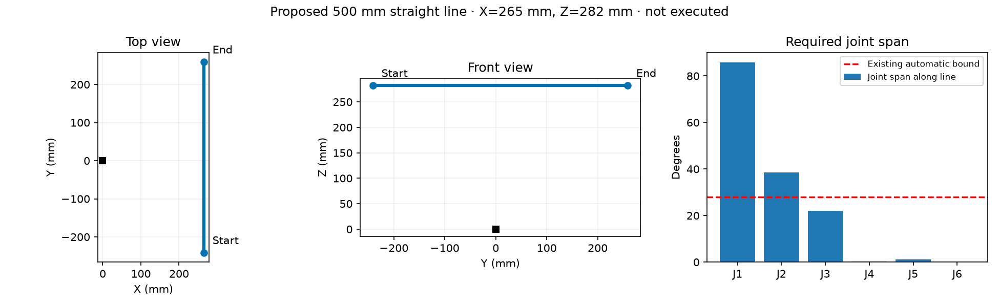

# Longer cruising test — approved automatic-excursion exception

The user approved this specific reviewed sweep and clearance request with
"go go go" on 2026-09-19. The exception is session-only; normal defaults remain
0.49 rad and will be restored after verified-rest disable.

A 500 mm straight line along world Y passes offline IK, interpolated joint bounds,
self-collision and reference velocity/acceleration/jerk checks at
20/30/40/50/60/80/100 mm/s. Checked approach and return paths also pass.
The requested TCP moves from (265, -241, 282) mm to (265, 259, 282) mm relative to
the robot base. At 100 mm/s it supplies 4.163 s of constant reference feed;
at 80 mm/s it supplies 5.502 s.

The largest required joint change is 1.498 rad (85.8°), on J1; the largest
rest-relative excursion is 0.931 rad (53.3°). This exceeds the AGENTS.md
requirement that automatic tests remain strictly below 0.49 rad relative to
current, rest and prior target. Execution results will be recorded in REPORT.md.

The proposed exception is a temporary 1.55 rad automatic-excursion ceiling for
this reviewed sweep, restored to 0.49 afterward. Start at 20 mm/s and increase
in steps. Preserve all SDK health/fault, finite-edge 5 mm, joint/collision and
reference derivative checks, friction-off and existing gains. Temporarily adjust
the POS_VEL speed ceiling only as required by each checked path, restoring
0.15 rad/s before verified-rest disable. No native gains, ACC/DEC, TIMEOUT or
Flash writes. End disabled at verified rest.

The model does not contain a measured table or surrounding objects; the user must
confirm the displayed sweep area is clear when approving the larger excursion.
The camera remains available without a manual camera gate, as previously requested.

[Detailed preflight](preflight.json) · [STEP line](assets/line-500mm.step)
