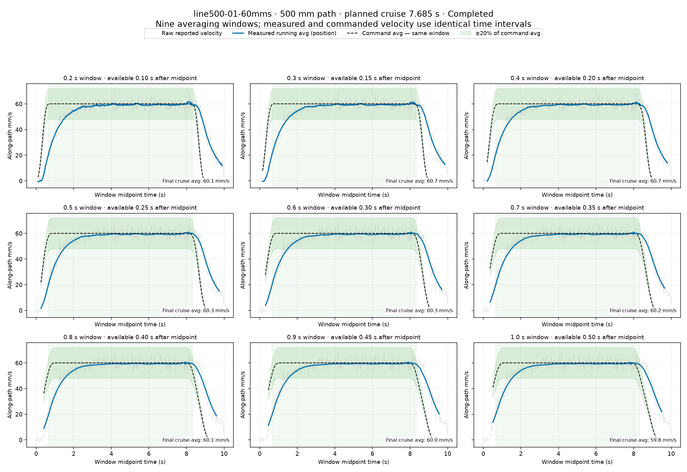

# 500 mm position–speed cruise sweep and nine velocity windows

Executed on 2026-09-19 after the user approved the reviewed sweep with “go go go”. Five 500 mm runs completed at **20/30/40/50/60 mm/s**. The **80 mm/s** attempt stopped at **3.938 s** when finite-edge distance reached **5.026 mm**. **100 mm/s was not executed on this longer path** because the lower-speed path had already exceeded its guard. The old 100 mm/s records remain available in the [120 mm nine-window report](../velocity-nine-windows/REPORT.md).

With enough distance, the position-derived running averages converge close to the command. The valid final cruise averages across all nine windows are within about **2.1%** of commanded feed at 20–60 mm/s. The last 1 s average before the 80 mm/s stop is **77.89 mm/s**. This is a partial run, not a completed or qualified 80 mm/s path.

## Completed and interrupted motion

| Command (mm/s) | Planned cruise (s) | Outcome | Max edge error (mm) | Max timed error (mm) | Raw valid cruise samples within ±20% |
|---:|---:|---|---:|---:|---:|
| 20 | 24.500 | Completed | 1.056 | 15.530 | 67.0% |
| 30 | 16.167 | Completed | 1.454 | 22.920 | 79.8% |
| 40 | 11.971 | Completed | 2.051 | 30.552 | 89.1% |
| 50 | 9.408 | Completed | 2.678 | 38.212 | 90.4% |
| 60 | 7.685 | Completed | 3.581 | 46.009 | 91.6% |
| 80 | 5.502 | Edge guard Hold | 5.026 | 57.899 | 78.6% |

Timed error is informational; only finite-edge distance controlled the position stop. These paths have unconstrained orientation, so the orientation number in the generic stop message was not the cause. No SDK communication, oscillation or execution-watchdog fault occurred. No run meets the unchanged requirement that every raw on-edge speed sample remain within ±20%. No stage is marked DONE.

## All nine final cruise averages (mm/s)

Each value uses a complete window ending at the planned end of constant reference feed. A dash means that window was invalid or the run did not reach the planned end; values are not extrapolated.

| Command | 0.2 s | 0.3 s | 0.4 s | 0.5 s | 0.6 s | 0.7 s | 0.8 s | 0.9 s | 1.0 s |
|---:|---:|---:|---:|---:|---:|---:|---:|---:|---:|
| 20 | 20.03 | 20.27 | 20.08 | 19.85 | 20.13 | 20.06 | 19.98 | 19.99 | 19.94 |
| 30 | 30.14 | 30.22 | 30.14 | 30.07 | — | — | — | — | — |
| 40 | 39.24 | 39.19 | 39.24 | 39.19 | 39.36 | 39.34 | 39.35 | 39.78 | 39.85 |
| 50 | 49.22 | 49.42 | 49.45 | 49.25 | 50.12 | 49.96 | 49.98 | 49.97 | 50.01 |
| 60 | 60.09 | 60.74 | 60.65 | 60.34 | 60.29 | 60.22 | 60.05 | 60.04 | 59.83 |
| 80 | — | — | — | — | — | — | — | — | — |

**30 mm/s:** a feedback timing gap invalidates final windows of 0.6–1.0 s. The latest valid 1 s window is **29.88 mm/s**, ending at 16.072 s (planned cruise ends at 16.667 s).

**80 mm/s:** the last observed pre-Hold averages for 0.2/0.3/0.4/0.5/0.6/0.7/0.8/0.9/1.0 s are 77.96, 77.93, 77.82, 77.74, 77.85, 78.16, 78.05, 78.05, 77.89 mm/s. These windows end at 3.938 s; they do not establish full-path accuracy.

## Measurement and interpretation

Blue curves use encoder positions, aligned to common feedback timestamps, converted through SDK forward kinematics to TCP position. Average velocity is signed displacement along the line divided by elapsed window duration. The black dashed command uses the exact same interval. Each full trailing window is displayed at its midpoint: in live use its value becomes available 0.1–0.5 s after that displayed midpoint. The nine values are averaging durations, not changes to hardware sampling rate.

Gray traces retain raw motor-reported velocity transformed by the TCP Jacobian. The previous audit found quantization and a raw velocity bias; no correction is silently applied to SDK safety feedback. Longer windows reduce that display fluctuation but also hide faster variation. These remain encoder/model estimates, with no external TCP metrology or verified torch calibration.

Windows overlapping stale/skewed/duplicate/backwards feedback or gaps over 50 ms are excluded. The 20 and 30 mm/s traces contain 8 and 7 invalid raw snapshots respectively; the other four contain none. All six legacy summaries also set `sampling_ok=false` because two startup rows clamp elapsed time to zero. The offline plots align real feedback timestamps and do not use that duplicated elapsed value as a differentiation interval. No historical acceptance result was rewritten. Regardless of this conservative startup flag, every run has raw cruise speed samples outside ±20%.

The longer records show real start-up lag before speed converges. Averaging alone does not fix the growing timed position lag or the lateral path error that stopped 80 mm/s. The present data support steady average feed at 20–60 mm/s on this one line; they do not qualify precision tracking globally or sustained 100 mm/s.

## Charts

[Compare final average against window duration](plots/window-comparison.png)

- [20 mm/s: all nine time-series panels](plots/line500-01-20mms-windows.png)
- [30 mm/s: all nine time-series panels](plots/line500-01-30mms-windows.png)
- [40 mm/s: all nine time-series panels](plots/line500-01-40mms-windows.png)
- [50 mm/s: all nine time-series panels](plots/line500-01-50mms-windows.png)
- [60 mm/s: all nine time-series panels](plots/line500-01-60mms-windows.png)
- [80 mm/s: all nine time-series panels](plots/line500-01-80mms-windows.png) — interrupted at edge guard.



## Final state and reproduction

Normal return and one-second rest verification succeeded; motors are disabled at maximum joint error **0.131°**. POS_VEL joint ceiling is restored to **0.15 rad/s** and automatic test excursion to **0.49 rad**. Saved motion limits, rest/gripper, MIT gains, gravity settings and friction-off state match the pre-run snapshot. The session changed no onboard gains, ACC/DEC, TIMEOUT or Flash. The viewer remains available on port 8081 with Position–speed selected and Enable available.

188 hardware-free tests and Ruff passed before motion. Ruff also passed after the plotting update. New tests cover the disabled-only, nonpersistent excursion exception and the measured excursion Hold. Plot generation and bulk checking happened with motors disabled.

Offline plot reproduction:

```bash
MPLCONFIGDIR=/tmp/autoweld-mpl .venv/bin/python -m scripts.plot_velocity_grid --source evidence/long-cruise --dest evidence/long-cruise/plots
```

[Numeric averages](plots/metrics.json) · [Validation summary](validation.json) · [Final rest status](final-rest-status.json) · [Preflight](preflight.json) · [Live runner](../../scripts/long_cruise_suite.py)

The live runner is a record of this authorized session, not a standing authorization to repeat larger excursions. The exception is off in the current process and in ordinary startup defaults.
