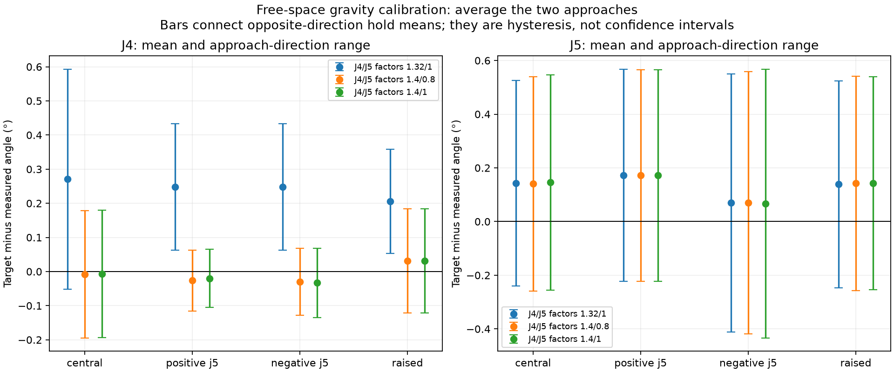
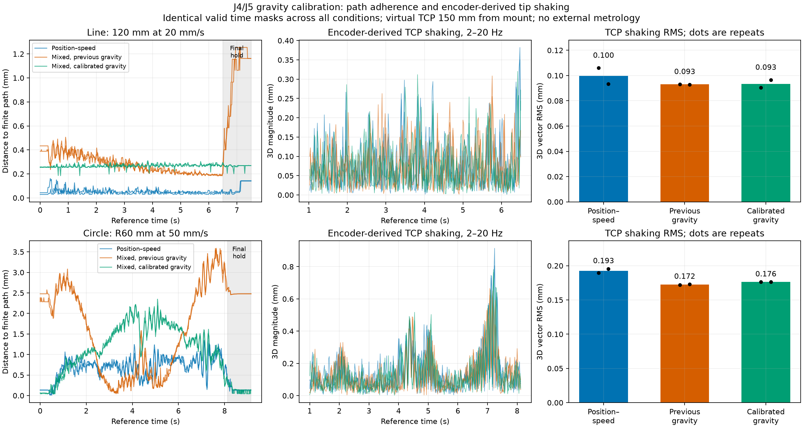
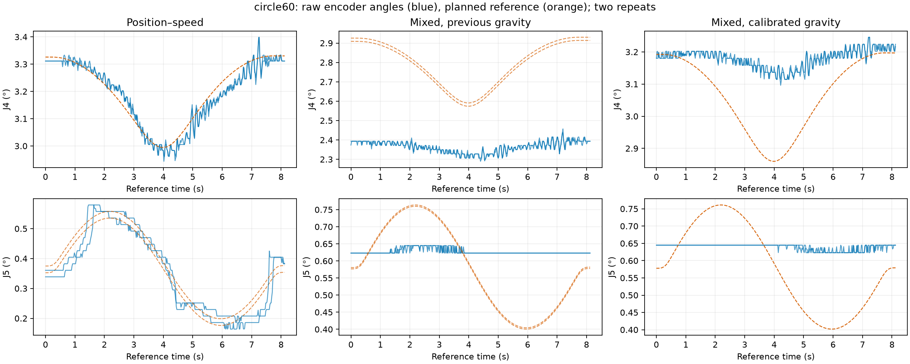

# J4/J5 gravity calibration and repeated path tests

**Gravity calibration improved path adherence, but did not reduce overall
encoder-derived end-effector shaking.** J4's useful local free-space factor is
**1.40**, up from 1.32. J5 remains **1.00**: a 0.80 trial produced no resolved
improvement. The mixed controller still under-tracks small wrist movements and
has larger path errors than all-arm position–speed.

The user authorized live tuning and had confirmed there was no board. Motor
communication used the SDK exclusively. Tests used the empty, closed gripper,
unchanged native/host P and D, I=0, friction off, and gravity on J4/J5 only.
No actuator register, Flash, guard, saved rest or operator motion-limit change
was made. All seven motors are now independently confirmed **disabled (0x0)**.

## Gravity calibration

Four free-space poses were measured from both directions, with a 0.03 rad J4/J5
approach offset, 2.5 s settling and a 3 s measurement window. Poses included J5
tilts of ±0.18 rad and a raised pose. All 16 approach/measurement waypoints passed
offline joint, collision, automatic excursion and motion-limit checks.
Supported rest was excluded from the fit.

For each pose, average the opposite-approach errors to estimate common bias and
retain half their difference as hysteresis. The local correction estimate is
`Kp × mean(target − encoder)`; fit that torque against unscaled SDK gravity.
This is a local holding-bias calibration, not a global mass/COM identification.

| J4 paired mean error, target minus encoder | Previous 1.32 | Candidate 1.40, J5 0.80 | Verification 1.40, J5 1.00 |
| --- | ---: | ---: | ---: |
| Central | +0.2707° | −0.0081° | −0.0071° |
| Positive J5 | +0.2481° | −0.0265° | −0.0203° |
| Negative J5 | +0.2481° | −0.0297° | −0.0329° |
| Raised | +0.2061° | +0.0311° | +0.0313° |

The initial J4 fit suggested 1.404; the independent verification suggests 1.398.
Keep the experimentally tested value 1.40. J4 approach dependence remains:
verification half-hysteresis is 0.085–0.187°, despite near-zero paired means.

J5 unscaled gravity is only roughly −0.017 to +0.015 Nm in the tilted poses and
near zero around the paths. The 20% change is only about 0.003 Nm at those poses.
Its paired bias remains +0.067–0.172°, while half-hysteresis is 0.393–0.501°.
The 0.80 trial barely changes those results. A gravity-only fit tries to absorb
a roughly 0.033 Nm constant residual and gives unstable near-zero/negative scale
estimates; those estimates were **not applied**. These measurements do not
identify a useful J5 gravity-factor correction.



Three rounds collected 24 hold windows. Gravity steps were at most 20%; no P/D
tuning occurred. The calibration runner restores the original gravity factors
before every return to the supported rest. This avoids applying a free-space
fit to an uncharacterized contact load; compensation was never switched by
travel direction during a path.

## Path adherence

Two complete repeats per condition: the same 120 mm vertical line at **20 mm/s**
and R60 mm YZ circle at **50 mm/s**, unconstrained orientation, inside-edge ramps.
Reference durations were 6.500 s and 8.131 s. Earlier baseline captures used the
same empty gripper and fixtures. The tuned captures are the complete
`tuned-verified-1790048980673266120` block.

Here “adherence” means encoder/FK distance to the finite edge, not mechanical
compliance under an applied force. Peak deviation includes the final one-second
hold; moving-path RMS excludes that hold.

| Path / condition | Peak deviation, two repeats | Moving-path RMS, mean | Path + final hold RMS, mean |
| --- | ---: | ---: | ---: |
| Line, position–speed | 0.162 / 0.140 mm | 0.051 mm | 0.059 mm |
| Line, previous mixed gravity | 1.254 / 1.254 mm | 0.291 mm | 0.463 mm |
| Line, calibrated mixed gravity | **0.304 / 0.310 mm** | **0.267 mm** | **0.267 mm** |
| Circle, position–speed | 1.347 / 1.314 mm | 0.739 mm | 0.699 mm |
| Circle, previous mixed gravity | 3.585 / 3.589 mm | 1.888 mm | 1.964 mm |
| Circle, calibrated mixed gravity | **2.222 / 2.349 mm** | **1.320 mm** | **1.246 mm** |

Relative to previous mixed mode, mean peak error decreases about **76% on the
line and 36% on the circle**. Moving-path RMS decreases **8% and 30%**. The large
line peak improvement is mostly at the endpoint: previous moving-only peaks
were 0.452 / 0.506 mm, then reached 1.254 mm during final hold.

Timed lag remains distinct from geometric deviation. Maximum timed errors are
5.575–5.670 mm on tuned lines and 11.258–11.328 mm on tuned circles. All four
references completed below the unchanged 10 mm record-only edge threshold.
This does not establish raw ±20% speed compliance or qualify Stage 3.



## Shaking amplitude and frequency

RMS is encoder-derived, in the **2–20 Hz** band, using identical valid time masks
across all six captures per fixture. The modeled TCP is 150 mm from the gripper
mount. There was no camera capture or external tip measurement in this test.

| Path / condition | TCP 3D RMS, mean | Conservative cruise RMS |
| --- | ---: | ---: |
| Line, position–speed | 0.09975 mm | 0.09604 mm |
| Line, previous mixed gravity | 0.09297 mm | 0.09045 mm |
| Line, calibrated mixed gravity | **0.09346 mm** | **0.09149 mm** |
| Circle, position–speed | 0.19268 mm | 0.15620 mm |
| Circle, previous mixed gravity | 0.17247 mm | 0.14476 mm |
| Circle, calibrated mixed gravity | **0.17638 mm** | **0.14973 mm** |

Gravity tuning gives **no tip-shaking improvement**: mean RMS is 0.5% higher on
lines and 2.3% higher on circles than the previous mixed condition. Two repeats
are insufficient to establish statistical significance for these small changes.
The 2–10 Hz sensitivity check reaches the same conclusion: line
0.08347→0.08539 mm, circle 0.16714→0.17125 mm.

| Joint / path | Previous mixed RMS | Calibrated mixed RMS | Spectral peaks before → after |
| --- | ---: | ---: | --- |
| J4, line | 0.009615° | 0.008470° | 9 / 9 → 9 / 9 Hz |
| J4, circle | 0.014002° | 0.012463° | 6.25 / 7 → 7.5 / 7.5 Hz |
| J5, line | Constant encoder code | 0.001576° | None → 5 / 3.75 Hz |
| J5, circle | 0.003769° | 0.004200° | 9 / 11.5 → 13.75 / 7.5 Hz |

J4's band RMS falls about 12% on lines and 11% on circles. J5 still produces
sparse one-count transitions; its changing peaks do not establish a repeatable
mechanical resonance. These joint metrics reprocess all conditions using
executor-time reference alignment and common masks, so they differ slightly
from the earlier publication-time joint analysis.

On the tuned circles, **J5 still moves only 0.02186° against a 0.35926° reference
span**. J4 moves 0.131–0.150° against 0.3372°. Mean J4 measured-minus-reference
bias changes to about +0.111°, but most of the requested small wrist variation
is still missing. Gravity calibration corrects holding bias; it has not solved
the small-motion response or removed the measured tip oscillation.



## Interrupted attempt and final state

Before the complete block, a line completed at 0.302 mm peak deviation. The next
circle was interrupted about 6.2 s into its 8.13 s reference by the existing
100 ms feedback/execution watchdog. The SDK latched a measured-pose hold with
factory MIT PD on J4/J5. Nearby telemetry records about 103 ms feedback age;
the logs do not establish the root cause of the scheduling/feedback delay.
There was no oscillation fault. **This interrupted circle is excluded**, and
the completed preliminary line is supplementary rather than part of the primary
two-repeat block. Both are retained with full logs.

Recovery first checked fresh, quiet positions, then used the SDK's independent
one-second quiet-window acknowledgement. Baseline gravity was restored and
normal rest disable passed at 0.37157°. The app was restarted disabled, restoring
the pre-experiment P/D profile after factory-gain fault recovery. The following
complete four-path block had no SDK faults, and final verified-rest disable
again passed at **0.37157°**. Independent SDK readback confirmed all seven
motors 0x0 and every surveyed register unchanged from before this task.

The source startup defaults are unchanged. Viser is running at port 8081 with
mixed mode selected, **motors disabled**, gravity factors restored to
`[1,1.04,1.31,1.32,1,1]`, speed ceiling 0.15 rad/s and automatic excursion 0.49 rad.
The useful free-space candidate `[1,1.04,1.31,1.40,1,1]` is saved in
`calibrated-profile.json`; it was not promoted to a global default because the
supported rest and other workspaces were not qualified with it. Safe UI feeds
remain line 20 / circle 10 mm/s; circle 50 was the requested experiment.

## Measurement limits and reproduction

All six joint feedback timestamps are deduplicated and interpolated onto a
50 Hz common grid; gaps above 50 ms split filtering, with one-second margins.
FK is calculated before filtering and reproduces recorded TCP coordinates
within 1e-6 mm. Reference joint values use executor elapsed time, avoiding
publication jitter. Matched coverage is 84.6% of each line and 87.8% of each circle;
cruise excludes another second around ramps. Four-second Welch windows have
0.25 Hz bins. Feedback quantization is about 0.02186° per count. These results
cannot separate encoder quantization from small physical oscillation, or detect
backlash/flex beyond the encoder. The old camera board RMS is not comparable.

The same Cartesian fixtures and feeds were used, but unconstrained IK references
adapt to the measured seed and are not identical joint trajectories. Controller
order was not randomized, with only two repeats per condition. No stage is DONE.

Offline reproduction:

```sh
OPENBLAS_NUM_THREADS=1 OMP_NUM_THREADS=1 .venv/bin/python -m scripts.analyze_mixed_gravity_holds
OPENBLAS_NUM_THREADS=1 OMP_NUM_THREADS=1 .venv/bin/python -m scripts.analyze_mixed_gravity_paths
.venv/bin/python -m pytest -q tests/test_gravity_hold_analysis.py tests/test_tcp_shaking_analysis.py tests/test_oscillation_analysis.py
```

Raw calibration/status/control captures, successful and failed path sessions,
`hold-analysis.json`, `path-metrics.json`, `shaking-metrics.json`,
`comparison-summary.json`, `watchdog-timing.json`, `final-rest-status.json`, and
`final-motor-survey.json` are retained here. Baseline raw captures remain in
`../mixed-wrist/`. Analysis tests cover known gravity-fit sign and hysteresis,
vector RMS, frequency extraction, constant encoder values and missing-data gaps.
