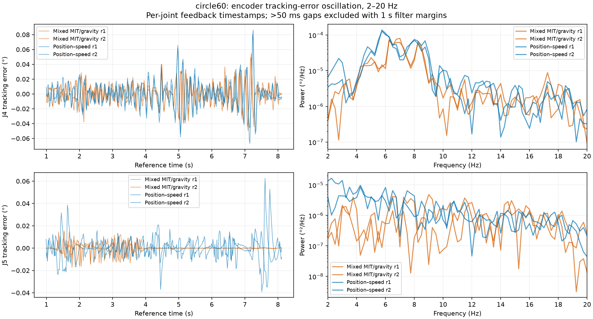
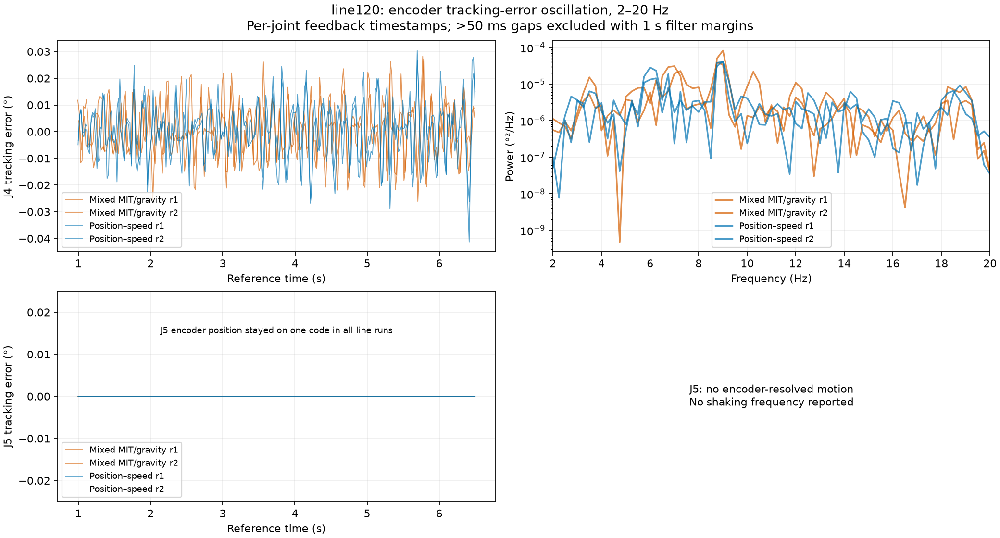
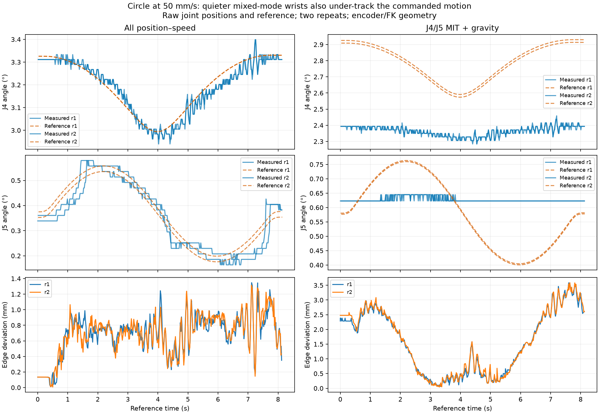

# J4/J5 MIT + gravity: live line and circle comparison

**Completed eight paths with no SDK faults. Mixed mode reduced encoder-visible
circle oscillation, but under-tracked the commanded wrist motion and worsened path
accuracy. It is not a better precision-control profile as tested.** The user
confirmed there was no ChArUco board; both conditions used the same empty gripper.

Two repeats each: a 120 mm vertical line at 20 mm/s and R60 mm YZ circle at 50 mm/s,
first all-arm position–speed, then J4/J5 MIT + gravity with J1–J3/J6 position–speed.
All references completed; maximum edge errors stayed below the unchanged 10 mm
record-only threshold. Normal disable succeeded at verified rest. An independent
SDK survey confirmed all seven motors disabled (0x0).

## Shaking amplitude and frequency

RMS below is the mean of two repeats of joint tracking error in the 2–20 Hz band,
using valid feedback timestamps and subtracting the planned joint motion. Peaks
are Welch spectrum maxima, **not identified mechanical resonance frequencies**.

| Path / joint | Position–speed RMS | Mixed RMS | Change | Position–speed peak | Mixed peak |
| --- | ---: | ---: | ---: | ---: | ---: |
| Line, J4 | 0.01015° | 0.00969° | 4.6% lower | 9.00 Hz | 8.75–9.00 Hz |
| Line, J5 | One constant encoder code | One constant encoder code | No resolved motion | — | — |
| Circle, J4 | 0.01735° | 0.01384° | 20.2% lower | 5.75 Hz in both | 6.25 / 7.00 Hz |
| Circle, J5 | 0.00945° | 0.00378° | 60.0% lower | 4.25 / 2.25 Hz | 9.00 / 3.75 Hz |

J5 circle peaks change between repeats: there is no single repeatable J5 frequency
to target from these data. The narrower 2–10 Hz check gives J4 circle RMS reductions
of 21.2%, J5 70.6%, and J4 line 4.8%. The direction of the result is consistent,
but the reduction depends on the measurement band.

| Path / joint | Position–speed peak-to-peak | Mixed peak-to-peak |
| --- | ---: | ---: |
| Line, J4 | 0.0557–0.0717° | 0.0532–0.0537° |
| Circle, J4 | 0.1385–0.1531° | 0.0919–0.1042° |
| Circle, J5 | 0.0879–0.1016° | 0.0297–0.0316° |

## Why lower shaking is not sufficient here

The subsequent [end-effector FK analysis](tcp-shaking/REPORT.md) gives 2–20 Hz
modeled TCP RMS **0.09975→0.09297 mm** for lines and **0.19268→0.17247 mm** for
circles (two-run means, exactly matched valid time windows). Thus the circle tip
estimate improves only 10.5%; conservative cruise improves 7.3%. This is an
encoder-derived virtual TCP result, not a new camera measurement.

The circle commanded about 0.359° of J5 angle variation. Position–speed produced
0.393–0.415°; mixed MIT produced just 0.02186°—one feedback count. J4 similarly
followed less of its requested approximately 0.34° variation: mixed measured spans
were 0.153–0.175°, compared with 0.437–0.459° in position–speed. These are full-path
ranges, separate from the filtered shaking amplitudes above.

Thus part of the quieter signal is a wrist that is not following the small
commanded angle changes. J4 also developed a sustained measured-minus-reference
bias: mean −0.380° on the line and −0.415° on the circle, versus +0.002° and −0.011°
with position–speed over the valid filtered intervals. Endpoint J4 errors after
the app's hold were about 0.25–0.27° on lines and 0.52–0.54° on circles in mixed mode.
The data do not isolate whether friction, MIT gain strength, gravity-model bias,
command quantization or their interaction dominates this behavior.

| Path | Position–speed maximum edge error, repeats | Mixed maximum edge error, repeats |
| --- | ---: | ---: |
| 120 mm line, 20 mm/s | 0.162 / 0.140 mm | 1.254 / 1.254 mm |
| R60 mm circle, 50 mm/s | 1.347 / 1.314 mm | 3.585 / 3.589 mm |

Timed error was 4.485–4.556 mm versus 3.083–3.189 mm for lines, and 11.185–11.200 mm
versus 12.806–12.833 mm for circles. Timed lag and finite-edge adherence are different
metrics; a reduction in one does not guarantee the other improves.

Recommendation: retain position–speed as the better demonstrated path-tracking
option. Before promoting mixed mode, investigate the free-space J4 holding bias
and poor small-angle wrist response. These tests do not justify increasing gains
or adjusting gravity against the supported rest contact. No gains were changed.

## Controller and path settings

- Baseline RAM KP_APR J1–J6:
  `[193.4917603,193.4917603,193.4917603,54,77.7600021,64.8000031]`.
- Mixed J4 Kp/Kd `29.85984 / 2.592`; J5 `14.4 / 1.5`. Existing MIT gains, I=0,
  friction off, MIT command quantization compensation off. SDK gravity factors
  J4/J5 `1.32 / 1.0`; linear model with exact SDK fallback beyond ±0.15 rad.
- Only CTRL_MODE on J4/J5 changed in RAM. Final independent readback matched every
  other surveyed register, including gains, ACC/DEC and watchdog. No Flash writes.
- Same STEP geometry, feed, unconstrained orientation, inside-edge ramps and
  durations (line 6.500 s; circle 8.131 s). The minimal-wrist IK solver uses measured
  approach pose, so absolute wrist references differ between conditions (roughly
  0.4° on J4 and 0.2° on J5); each run is compared with its own recorded reference. Reference wrist variation
  remained close between conditions. Controller order was baseline then mixed,
  not randomized, and there were only two repeats per condition.
- Both fixtures fit the original 0.49 rad automatic excursion bound; maximum
  planned rest excursion 0.407761 rad and path joint span 0.448349 rad. Temporary
  ceiling 0.25 rad/s, restored to 0.15 afterward. Saved motion limits/rest unchanged.
  Selected safe UI feeds remain line 20 / circle 10 mm/s; circle 50 is experimental.
- Small commissioning overshoot passed standing limits. Mixed J2 maximum was
  0.00315°, with zero directed J4/J5 overshoot in that small move. This does not
  qualify all poses or establish general settling performance.

## Failed setup attempts retained

1. Mixed startup held the newly measured target with J4 about 1.246° away. The
   recorder's extra 0.008 rad gate stopped the session before a path. Explicit
   captured-rest return then disabled normally at 0.393° maximum error.
2. An explicit-rest startup passed commissioning, but the raised standby pose held
   J4 0.549° below target, failing the same extra recorder gate. No tracking path ran;
   normal rest disable passed at 0.350°.
3. Final acquisition used the standing 0.2° proximal / 1° wrist tolerance for
   standby moves. Approach to path start used 0.0099 rad; the SDK's independent
   0.01 rad start limit, 0.05 rad/s idle threshold, joint/collision checks, oscillation
   guard and 100 ms execution watchdog were unchanged. All four mixed paths ran.

No SDK communication, oscillation or execution-watchdog fault occurred in any of
these sessions. The first two attempts are excluded from the path comparison,
with complete session logs retained. A failed experiment settle check did not block
normal verified-rest disable.

## Measurement limits and reproducibility

Per-joint feedback timestamps are deduplicated and resampled at 50 Hz. Gaps over
50 ms split the data; one second at each filter boundary is excluded. The app's
planning/start publication gaps leave about the first second unavailable for the
band comparison: retained coverage is 84.6–84.9% of lines and 87.8% of circles.
Plots explicitly begin around one second; no missing interval is interpolated
across. Four-second Welch windows provide 0.25 Hz bins. Reference timestamps use
host publication time with a small unmeasured publication offset.

Feedback quantization is about 0.02186° per count. Band RMS below one count is a
statistic of code transitions, not proof of sub-count physical resolution. A
constant encoder code on line J5 produces no reported shaking frequency; tiny
reference/numerical residuals are omitted from the interpretation. These are
encoder-visible measurements. They do not capture backlash beyond the encoder,
structural flex or independently measured tip shaking. No camera measurement was
made in this board-free session; the prior camera RMS is not directly comparable.

Files:
- `comparison-summary.json`: compact before/after metrics.
- `oscillation-metrics.json`: all six joints, both frequency bands, per repeat.
- `*-r1/2.json`, `*-r1/2.jsonl`, `*-r1/2-control.jsonl`: status, tracking and full
  control/encoder captures.
- `*-session.json` / `*-session-control.jsonl`: commissioning and failed attempts.
- `final-rest-status.json`, `final-motor-survey.json`: final verified rest and
  independent all-seven-disabled/register readback.
- `preflight.json`, `assets/`: fixture geometry and offline checks.

Reproduce plots offline with `python -m scripts.analyze_mixed_wrist`. Acquisition
uses `scripts/mixed_wrist_trial.py` through the SDK app inbox and requires explicit
live-motion authorization. The synthetic frequency/RMS, missing-data and
constant-encoder analysis tests pass, as does Ruff. Controller implementation
validation remains the previously recorded 227 full tests plus 106 affected tests
including the startup-cache fix. SDK patch reproduction passed.

Final state: Viser is running on port 8081, mixed controller selected but **all
motors disabled**. Last live rest check was 0.37157° maximum error for one second;
subsequent independent SDK motor statuses were all 0x0. Gripper is empty and
unpowered, with closed intent retained for reconnect. No stage is marked DONE,
and no new controller or gains are promoted as startup defaults.
