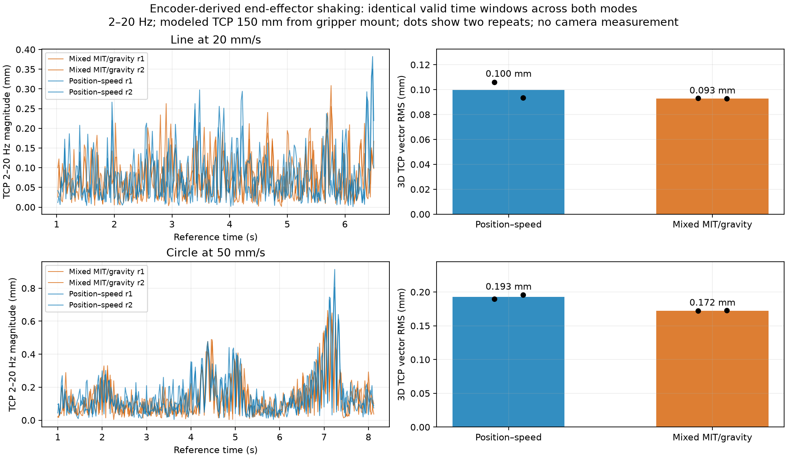

# End-effector shaking from the mixed-controller recordings

**At the modeled TCP, mixed mode reduced circle RMS by 10.5% and line RMS by 6.8%,
considerably less than the J5-only reduction.** This is an offline encoder/FK
estimate from the same eight board-free paths, not a new camera measurement.
No robot commands were issued for this analysis.

Values below are the mean of two runs, using the 3D vector RMS
`sqrt(mean(x_band² + y_band² + z_band²))` in the 2–20 Hz band. The measurement
point is the existing virtual welding TCP, **150 mm along gripper-mount −Z**.

| Path / interval | All position–speed | J4/J5 MIT + gravity | Reduction |
| --- | ---: | ---: | ---: |
| Line, 20 mm/s, valid path interval | 0.09975 mm | 0.09297 mm | 6.8% |
| Line, conservative cruise interior | 0.09604 mm | 0.09045 mm | 5.8% |
| Circle, 50 mm/s, valid path interval | 0.19268 mm | 0.17247 mm | 10.5% |
| Circle, conservative cruise interior | 0.15620 mm | 0.14476 mm | 7.3% |

Individual path-interval repeats were line **0.10608 / 0.09343 mm** versus
**0.09318 / 0.09277 mm**, and circle **0.18970 / 0.19567 mm** versus
**0.17198 / 0.17296 mm**. The line repeat ranges nearly overlap; two repeats do not
establish a reliable small improvement across other poses or loads.

TCP spectral maxima were about 3.5 Hz for lines in both modes; circles were
5.75–6 Hz for position–speed and 5–6.25 Hz for mixed. These are broad, finite-run
spectrum maxima, not identified mechanical resonances. The line's conservative
cruise interior is shorter than the fixed four-second Welch window, so no separate
cruise frequency is reported.

At the **gripper mount**, without the virtual 150 mm offset, path-interval vector
RMS was line **0.06072 → 0.05615 mm** and circle **0.11226 → 0.10412 mm**. A real
board corner, gripper tip or torch tip will have a different lever arm.

## Interpretation

Changing only J4/J5 does not remove all six joints' contributions to Cartesian
motion. The reduction at the modeled TCP is modest. As shown in the
[joint/path report](../REPORT.md), mixed J5 followed only one encoder count against
a 0.359° circle command and J4 developed a holding bias. Circle maximum edge error
worsened from 1.31–1.35 to 3.58–3.59 mm. Lower high-frequency RMS and worse slow
path adherence coexist; these are different measurements.

The previous camera result near **0.339 mm RMS** remains a measurement of the
ChArUco board center in another loaded run. It was not remeasured here. The virtual
TCP, board center and gripper mount are different points, with no calibrated
board-to-TCP transform. Encoder-derived RMS does not capture flex or backlash
beyond the encoder and includes feedback quantization effects. It does not prove
that externally observed shaking decreased by the same amount.

## Method and checks

- Each joint's positions use its own feedback timestamps. Duplicate times are
  removed, then all six angles are interpolated onto a common 50 Hz grid anchored
  to reference start. Any >50 ms gap in any joint invalidates that grid interval.
- FK is computed from the aligned angles before filtering. The offline model
  reproduces the recorded tracking TCP positions to less than 0.000001 mm.
- A fourth-order Butterworth 2–20 Hz bandpass is applied forward/backward within
  each continuous valid segment. One second at each segment boundary is excluded.
  The masks are intersected across all four runs of each fixture, giving exactly
  the same relative path times in both conditions.
- Common coverage is 5.50 s / 84.6% for lines and 7.14 s / 87.8% for circles;
  approximately the first second is excluded after app start/publication gaps.
  Cruise excludes each planned ramp plus one second: 3.52 s of sampled line data
  and 4.94 s of circle data. Sample-count duration includes endpoint samples.
- The executor's own elapsed timestamps place the planned reference in time.
  Using telemetry publication time instead would add artificial reference jitter.
  Subtracting the planned TCP before filtering yields path-interval RMS
  **0.09949 → 0.09295 mm** for lines and **0.19373 → 0.17345 mm** for circles,
  essentially the same comparison. Residual band energy in the planned reference
  is associated mainly with ramps; cruise reference RMS is below 0.001 mm.
- The 2–10 Hz check gives line **0.09130 → 0.08347 mm** and circle
  **0.18804 → 0.16714 mm**, preserving the conclusion. Frequencies above the
  the 25 Hz Nyquist limit of the 50 Hz analysis grid cannot be assessed; no anti-alias
  guarantee is established by these logs.
- Vector-RMS rotation invariance and gap/filter-boundary handling tests pass.
  Ruff passes. The original raw logs remain unchanged.

Reproduce with `python -m scripts.analyze_mixed_tcp` while hardware is disabled.
`metrics.json` contains both bands, phases, axes, mount/TCP and reference-subtracted
metrics. `timing.json` records per-joint sampling/gaps; each `*-signals.csv` contains
the matched 2–20 Hz vectors. `summary.json` contains the primary mean comparisons.

The arm remains disabled; this follow-up performed analysis only.
