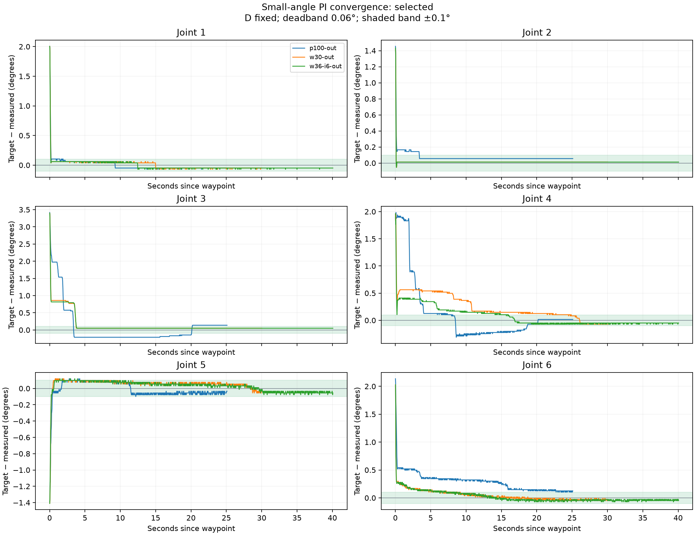
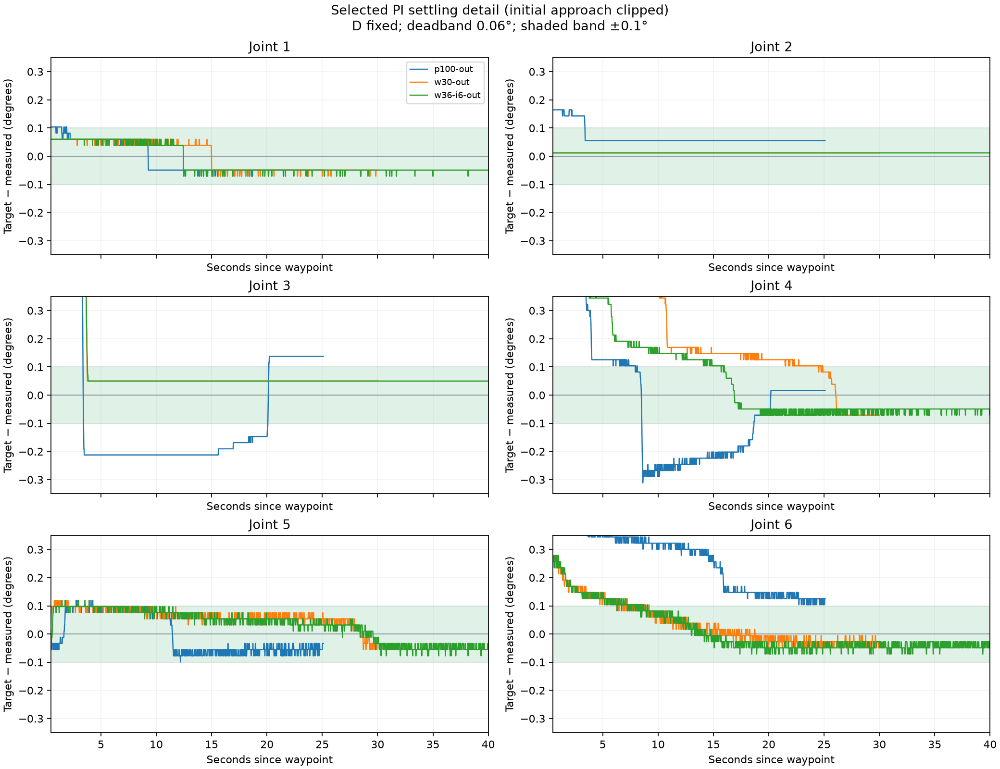
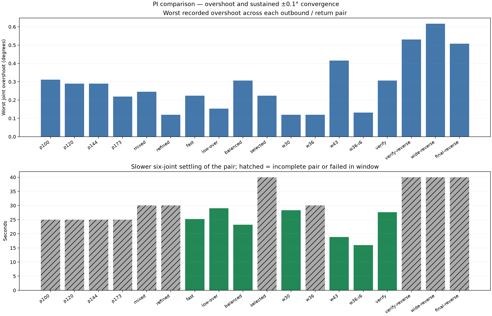
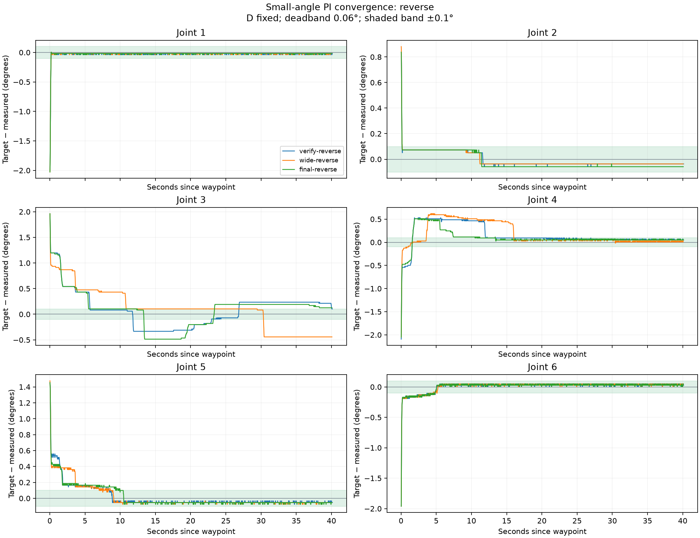

# PI tuning with fixed D — 2026-09-14

**The best standard-cycle candidate is saved, but broad 0.1° convergence is not achieved.** Its standard outbound/return tests settled in 16.00 / 11.35 s with 0.131° worst sampled overshoot. Its opposite-direction validation reached 0.508° overshoot and failed to remain within 0.1° during a 40-second recording. These settings are a measured candidate, not a fully validated fast controller.

## Selected settings

| Setting | J1 | J2 | J3 | J4 | J5 | J6 |
|---|---:|---:|---:|---:|---:|---:|
| P (Nm/rad) | 96 | 115.2 | 138.24 | 35.831808 | 13.824 | 29.85984 |
| I (Nm/(rad·s)) | 40 | 40 | 60 | 6 | 3 | 6 |
| D (unchanged) | 5 | 5 | 5 | 1.5 | 1.5 | 1.5 |

Deadband is **0.06°**. I resets on a changed waypoint and begins after 0.5 s; identical repeated targets preserve I. Integral torque caps remain ±5 Nm on J1–J3 and ±1 Nm on J4–J6. Gripper P/D, gravity and friction compensation remain unchanged; the gripper has no I. The original PD function is byte-for-byte unchanged and remains the startup default.

The UI exposes P and I, keeps D fixed, and atomically rejects P changes larger than 20% of the current setting. Code defaults and the live UI contain the selected candidate. The live app is left in **PD with motors disabled at verified rest**; Enable motors remains available. Last measured arm/rest error was 0.1967°. Normal disable verified all seven joints within 0.5° for one second.

## Selection and limitations

For standard outbound/return tests, exclude profiles with an incomplete pair or any recorded standard trial that did not settle and remain within 0.1°. For each remaining profile, take the maximum sampled overshoot across joints, directions and repeats, then select the smallest maximum. [The audit](selection-audit.json) recomputes this ranking from saved summaries. Opposite-direction validation is reported separately because most screened candidates were not tested on that additional target. This is not a global optimum over poses or gains.

The initial apparent winner (`pi-w30`) had 0.119° worst standard-cycle overshoot, but its repeated return reached 0.306°. It was rejected in favor of `pi-w36-i6`, whose standard-cycle maximum was 0.131°. The 0.012° difference between their first screenings is smaller than one encoder increment; the later 0.306° spike is material. The selected profile has only one standard-cycle pair, so its repeatability is not established.

The factory-P baseline outbound overshoot was 0.311° and it failed to settle within 25 s. The selected profile’s outbound overshoot was 0.119°; its return maximum was 0.131°. Raising J4 P to about 43 produced 0.415° return overshoot at 0.139 s, before I activated, so that increase was rejected.

Opposite-direction tests exposed additional late elbow overshoot while I accumulated. Lowering elbow I and raising elbow P did not improve that case. The selected candidate’s final alternate test reached 0.486° elbow overshoot and 0.508° wrist overshoot; elbow error still reached 0.148° in the final two seconds. These data do not prove a mechanical or gravity-model cause. **The broader accuracy objective remains unresolved.**

## Plots

Standalone PDFs: [selected convergence](convergence-selected.pdf), [settling detail](settling-selected.pdf), [comparison](comparison.pdf), [opposite directions](convergence-reverse.pdf). Complete outbound/return overlays are in `convergence-out.png` and `convergence-return.png`.

## Procedure and measurement scope

All communication used the running app’s single SDK connection. The camera covered the full arm. Standard target offsets from captured rest were `[0.035, 0.025, 0.06, 0.035, -0.025, 0.035]` rad, followed by return to rest. The alternate target was `[-0.035, 0.015, 0.035, -0.035, 0.025, -0.035]` rad, commanded from rest. Observation windows were 25–40 s, as listed below. Long holds matter because several early tolerance passes were followed by drift.

Across 34 completed recorded trials, the largest measured joint excursion from captured rest was 0.06485 rad. Every P change, including restoration through measured rest holds, was at most 20.0%; D stayed fixed and every recorded gain matched its trial configuration. The audit includes [restoration steps](restoration-steps.json). SDK gripper calibration on restart was separately authorized; the gripper stayed fixed during arm trials.

The first baseline return recorder was interrupted when the next test started. That incomplete recording is excluded. A single-recorder lock was added so a second test cannot start while one is recording. No interrupted trial is treated as a successful result.

Overshoot means sampled travel past the target in the commanded direction, not the initial target error. Joints with less than 0.1° actual step are excluded from directional overshoot. Settling is the start of the final uninterrupted six-joint ±0.1° interval, accepted only if at least one second remains in the recording. A dash means that did not occur within the window. A final-two-second maximum can include a failure before a very late accepted settling time.

Encoder resolution is approximately 0.02186° per increment. Approximately 50-Hz telemetry does not establish continuous-time peak overshoot, physical zero calibration, TCP accuracy or absence of jerk. Tests cover small angles near one captured rest pose with the current gripper/load. No welder trigger or Stage 2 work was performed.

## Complete trial summaries

| Trial | Window s | Worst overshoot ° | Final sustained settle s | Worst final-2-s error ° |
|---|---:|---:|---:|---:|
| [pi-p100-out](../pid/pi-p100-out.json) | 25 | 0.311 | — | 0.137 |
| [pi-p120-out](../pid/pi-p120-out.json) | 25 | 0.290 | — | 0.148 |
| [pi-p120-return](../pid/pi-p120-return.json) | 25 | 0.087 | 21.87 | 0.087 |
| [pi-p144-out](../pid/pi-p144-out.json) | 25 | 0.290 | — | 0.148 |
| [pi-p144-return](../pid/pi-p144-return.json) | 25 | 0.131 | 21.02 | 0.087 |
| [pi-p173-out](../pid/pi-p173-out.json) | 25 | 0.202 | — | 0.148 |
| [pi-p173-return](../pid/pi-p173-return.json) | 25 | 0.219 | 18.79 | 0.087 |
| [pi-mixed-out](../pid/pi-mixed-out.json) | 25 | 0.246 | — | 0.104 |
| [pi-mixed-return](../pid/pi-mixed-return.json) | 30 | 0.131 | 21.53 | 0.087 |
| [pi-refined-out](../pid/pi-refined-out.json) | 30 | 0.119 | 16.98 | 0.093 |
| [pi-refined-return](../pid/pi-refined-return.json) | 30 | 0.066 | — | 0.109 |
| [pi-fast-out](../pid/pi-fast-out.json) | 30 | 0.224 | 25.22 | 0.077 |
| [pi-fast-return](../pid/pi-fast-return.json) | 30 | 0.066 | 17.79 | 0.066 |
| [pi-low-over-out](../pid/pi-low-over-out.json) | 30 | 0.119 | 24.25 | 0.077 |
| [pi-low-over-return](../pid/pi-low-over-return.json) | 30 | 0.153 | 29.01 | 0.109 |
| [pi-balanced-out](../pid/pi-balanced-out.json) | 30 | 0.119 | 19.06 | 0.077 |
| [pi-balanced-return](../pid/pi-balanced-return.json) | 40 | 0.306 | 23.21 | 0.066 |
| [pi-selected-out](../pid/pi-selected-out.json) | 40 | 0.224 | — | 0.137 |
| [pi-selected-return](../pid/pi-selected-return.json) | 40 | 0.066 | 30.76 | 0.087 |
| [pi-w30-out](../pid/pi-w30-out.json) | 30 | 0.119 | 24.90 | 0.071 |
| [pi-w30-return](../pid/pi-w30-return.json) | 30 | 0.066 | 28.31 | 0.109 |
| [pi-w36-out](../pid/pi-w36-out.json) | 30 | 0.119 | — | 0.104 |
| [pi-w36-return](../pid/pi-w36-return.json) | 30 | 0.066 | 25.29 | 0.087 |
| [pi-w43-out](../pid/pi-w43-out.json) | 30 | 0.098 | 18.88 | 0.077 |
| [pi-w43-return](../pid/pi-w43-return.json) | 30 | 0.415 | 8.51 | 0.066 |
| [pi-w36-i6-out](../pid/pi-w36-i6-out.json) | 40 | 0.119 | 16.00 | 0.077 |
| [pi-w36-i6-return](../pid/pi-w36-i6-return.json) | 40 | 0.131 | 11.35 | 0.066 |
| [pi-verify-out](../pid/pi-verify-out.json) | 40 | 0.119 | 23.29 | 0.077 |
| [pi-verify-return](../pid/pi-verify-return.json) | 40 | 0.306 | 27.66 | 0.087 |
| [pi-verify-reverse](../pid/pi-verify-reverse.json) | 40 | 0.530 | — | 0.235 |
| [pi-verify-reverse-return](../pid/pi-verify-reverse-return.json) | 40 | 0.131 | — | 0.109 |
| [pi-wide-reverse](../pid/pi-wide-reverse.json) | 40 | 0.617 | — | 0.443 |
| [pi-wide-reverse-return](../pid/pi-wide-reverse-return.json) | 40 | 0.109 | — | 0.109 |
| [pi-final-reverse](../pid/pi-final-reverse.json) | 40 | 0.508 | — | 0.148 |

Each linked summary contains exact gains and targets; its matching `.jsonl` contains raw observations. [Selected profile](selected-profile.json), [final state](final-state.json), [verified rest image](verified-rest.jpg).

## Software validation

53 unit tests pass; app, tests and scripts pass Ruff. Tests cover original-PD source equality, unchanged D and gripper P, P changes bounded against current settings, atomic rejection, integral timing/reset/windup and stale feedback. Updated offline end-to-end smoke passed and ended with simulation disabled. The tracked SDK patch was applied to a fresh copy of the pinned source and reproduced both deployed SDK files exactly. Offline ideal motion is not live convergence evidence.

**Stage 1 remains unfinished.** The fixed-D PI search improved the tested standard cycle, but opposite-direction convergence and repeatable low overshoot remain unresolved.
