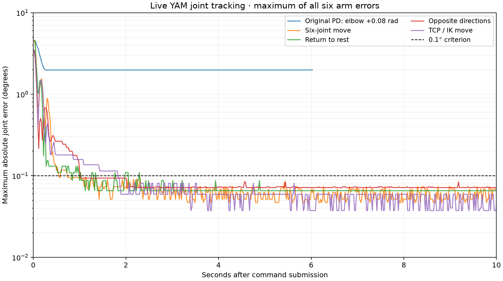

# Superseded PID tuning — 2026-09-14

Historical report. The later user-authorized P/I comparison with fixed D and 0.06° deadband is in the [current PI report](../pi/REPORT.md).
**The user rejected this higher-P profile because of jerky motion. PID now uses factory P/D gains and only Ki is tunable. The measurements below are historical and do not validate the revised controller.**

The saved PID profile passed all four final near-rest trials. Original PD remains selectable and its SDK command function is unchanged. All communication used the i2rt SDK through the single running Viser app.

| Final trial | Settled and remained ≤0.1° | Observation | Worst error in final 2 s |
|---|---:|---:|---:|
| Six-joint move | 0.74 s | 10 s | 0.0734° |
| Return to rest | 2.31 s | 10 s | 0.0656° |
| Opposite directions | 1.02 s | 10 s | 0.0843° |
| TCP / IK move | 1.84 s | 20 s | 0.0592° |

Settling is the first sample after the last tolerance violation, with at least one full second of subsequent feedback. Each result includes all six joints. Final TCP testing held the target for 20 seconds, remaining within 0.1° after 1.84 seconds. Times include command submission and IK solving where applicable; sampling was approximately 50 Hz.

The PD baseline used an elbow-only +0.08 rad move and settled 1.983° short. The plotted PID trials include coupled moves and a different captured rest session; this is commissioning evidence, not a controlled statistical comparison.

## Saved SDK PID settings

- Kp (Nm/rad): `[160, 160, 320, 80, 40, 40]`.
- Ki (Nm/(rad·s)): `[160, 160, 640, 160, 40, 40]`.
- Kd: original SDK `[5, 5, 5, 1.5, 1.5, 1.5]`.
- Integral deadband: `0.075°`; torque bounds: `[5, 5, 5, 1, 1, 1]` Nm.
- Friction and gravity compensation remain enabled; no gripper integral term.
- Old PD uses its original Kp `[80, 80, 80, 10, 10, 10]` and original Kd. Startup defaults to PD; the tuned PID profile is selectable.

Integral-only tuning with original P gains improved error but produced slow settling and stick-slip. PID-specific proportional gains and the deadband removed the late drift observed in those trials. Failed/intermediate trials are retained in this directory, rather than excluded from the evidence.

## Per-joint maximum error over the final two seconds

| Trial | J1 | J2 | J3 | J4 | J5 | J6 |
|---|---:|---:|---:|---:|---:|---:|
| Six-joint move | 0.0250° | 0.0297° | 0.0374° | 0.0624° | 0.0734° | 0.0687° |
| Return to rest | 0.0656° | 0.0219° | 0.0656° | 0.0437° | 0.0219° | 0.0656° |
| Opposite directions | 0.0687° | 0.0531° | 0.0718° | 0.0624° | 0.0734° | 0.0843° |
| TCP / IK move | 0.0183° | 0.0208° | 0.0167° | 0.0193° | 0.0592° | 0.0331° |

## Scope and reproducibility

Targets were near captured rest: joint offsets were at most 0.10 rad, and every automatic request passed the app’s checks against current, rest and prior targets (<0.49 rad). The gripper stayed fixed during arm trials. No ROS, direct CAN commands, trajectories, or additional derivative damping were used.

These are SDK encoder-feedback errors, not externally measured absolute joint accuracy or calibrated TCP accuracy. The encoder increment is approximately 0.02186°. Larger excursions, different poses, loads, or a replacement welding torch require further validation. Stage 1 has not been marked DONE.

The separate SDK helper and command entry point are reproduced by `patches/i2rt-integral.patch`; setup applies it to the pinned SDK. Unit tests verify original PD source preservation, P-gain isolation, integral time scaling, windup, deadband, stale-cycle reset and gripper exclusion. All 49 tests and the offline UI smoke check passed. SDK lint has one pre-existing constructor argument-count finding.

Raw final trials: `final-all.jsonl`, `final-return.jsonl`, `final-alternate.jsonl`, `final-ik.jsonl`. JSON summaries include exact targets, gains and timestamps. The final rest reference and motor lifecycle results are recorded alongside them.

Final UI lifecycle check: selected PD, selected PID, applied gains, enabled in PID Hold, then returned and disabled. Session rest was preserved. Final measured maximum rest error: 0.1311°, verified for one second before SDK close. Motors are disabled; Enable motors is available. See `enabled-state.json` and `final-state.json`.
