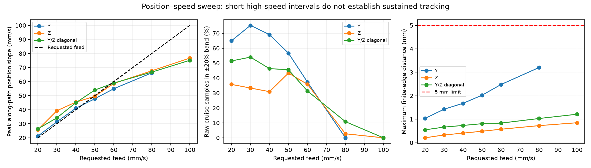

# Position–speed tests through 100 mm/s

Later [velocity audit](../velocity-audit/REPORT.md): the original position-slope
statistics below used a delayed estimate against the current reference interval.
Correct time/pose alignment and an independent distance/time check give about
55 mm/s during the 100 mm/s plateau, rather than approximately 51 mm/s. Historical
traces and raw-speed qualification are preserved; the physical lag remains.

The arm completed 20 bounded, 120 mm straight-line trials at requested feeds of
20, 30, 40, 50, 60, 80 and 100 mm/s. All completed trials stayed within the global
5 mm finite-edge tolerance; the worst edge distance was 3.204 mm. **None qualified
on raw ±20% feed speed. Commanding 100 mm/s did not establish sustained 100 mm/s
motion.** All stages remain unqualified overall and none is marked DONE.

At 100 mm/s the reference's constant-speed segment lasted only 0.363 s. Along-path
speed estimated from 120 ms position slopes averaged 50.5–50.9 mm/s during that
segment. It peaked at 75.2–76.7 mm/s later, during reference deceleration. Raw
Jacobian speed peaks over the full trace were 78.5–81.5 mm/s. Timed position lag
reached 54.947 mm; this remained informational under the requested edge-distance
criterion. The earlier approximately 61 mm/s position-slope peak quoted during
the run covered only the reference's constant-speed segment, not the full trace.

## Feed comparison

The late speed column is the range of mean **along-path position-slope estimates
over the second half of the constant-speed segment**. It is a delayed diagnostic,
not the raw speed criterion. The raw in-band column averages the percentage of
constant-speed samples inside ±20% across the tested directions. A mean near the
target does not qualify a fluctuating trace.

| Requested feed (mm/s) | Completed paths | Constant-speed interval (s) | Late estimated speed (mm/s) | Raw samples in band | Maximum edge distance (mm) |
|---:|---:|---:|---:|---:|---:|
| 20 | 3 | 5.500 | 19.9–19.9 | 50.7% | 1.036 |
| 30 | 3 | 3.500 | 29.1–29.3 | 54.2% | 1.428 |
| 40 | 3 | 2.471 | 36.9–37.5 | 48.8% | 1.680 |
| 50 | 3 | 1.808 | 43.4–44.1 | 48.5% | 2.026 |
| 60 | 3 | 1.352 | 48.3–49.4 | 34.8% | 2.481 |
| 80 | 3 | 0.752 | 54.1–55.9 | 4.5% | 3.204 |
| 100 | 2 | 0.363 | 56.4–56.8 | 0.0% | 1.214 |

The three directions are Y, Z and a Y/Z diagonal. The 100 mm/s Y candidate was
rejected before motion because its required acceleration/jerk ramps left no
constant-feed section on the 120 mm edge. The two other directions ran at 100.
Consequently the smaller worst edge distance at 100 is **not** a matched
three-direction improvement over 80.

The 20–30 mm/s paths had enough travel to approach the requested mean speed late
in the move, but their raw traces still fluctuated beyond the allowed band.
Higher requested feeds shortened the available convergence time and increased
lag. These trials do not identify friction as the cause, or measure the maximum
sustained speed on a longer path. All measurements derive from motor feedback
and SDK kinematics, with no external tip metrology. Position slopes use a trailing
120 ms window and therefore add delay.

## Setup and changes

- POS_VEL arm control remained selected; the gripper retained MIT. The existing
  onboard gains, ACC/DEC, TIMEOUT and Flash settings were unchanged. Host friction
  stayed off; POS_VEL supplies no host torque-feedforward channel. Saved MIT
  settings, captured rest and operator motion limits were preserved.
- The generated [STEP fixture](assets/lines-120mm.step) contains five 120 mm
  edges; indices 0, 2 and 3 were selected using the established seed poses.
  [Preflight results](preflight.json) record each candidate. Automatic excursions
  remained strictly below 0.49 rad relative to current, rest and prior target,
  alongside joint, collision, interpolation and derivative checks.
- Added an idle-only **position-speed ceiling** control. It starts at 0.15 rad/s,
  permits at most 1 rad/s and cannot exceed the operator joint-speed limit.
  This sweep used per-path ceilings of 0.15–0.40 rad/s, allowing 25% above the
  planned joint peak rounded upward to 0.05 rad/s. The ceiling was restored to
  0.15 rad/s before return to rest; it is not persisted.
- Added **Inside edge** acceleration placement so the faster ramps stay on the
  finite requested edge. The original **Outside edge** remains the UI default.
  The edge guard covers acceleration, constant feed, deceleration and final hold;
  feed qualification covers the constant-speed interval. Each result records
  that interval. This is a different ramp placement from the earlier 60 mm tests.
- A requested feed can equal the operator TCP speed limit. The planner permits
  only 1 µm/s numerical spline/Jacobian tolerance at that boundary and retains
  its 5% reserve on other planned derivatives. Physical derivatives remain
  unqualified; reference limits are not measured-motion guarantees.
- Orientation was unconstrained. This sweep does not add circle, constrained
  orientation, or Stage 1 step-response qualification. Completion means the
  recorded path and one-second final hold finished without an edge stop; it does
  not establish endpoint settling or speed compliance.

## Interrupted attempts and fixes

Two initial attempts are archived separately and excluded from the 20 primary
completed trials. The issues were repaired before their successful retries.

1. A vertical 30 mm/s attempt tripped the unchanged 100 ms execution/feedback
   watchdog just after startup. Feedback age was already 96.28 ms before reaching
   104.59 ms; the new reference had advanced only 6.55–10.62 ms. The exact cause
   of the communication/scheduling gap is not established. Fresh/quiet SDK
   recovery and normal verified-rest disable succeeded at 0.153° maximum error.
   Planned motion now waits after validation for a new feedback frame no older
   than 20 ms, with joint speed at most 0.05 rad/s; failure rejects the start.
   No running guard was relaxed. See [startup incident](initial-watchdog/README.md).
2. The first 40 mm/s Y run exposed NumPy scalar values in JSON status reporting.
   Repeated reporting exceptions also blocked the old application's lifecycle
   tick after a requested return. SDK-only recovery independently verified fresh,
   quiet captured rest for 1.019 s, with at most 0.240° error across all seven
   motors, then disabled and read back all motors as status `0x0` before removing
   the broken process. Timing values and result booleans are now native Python
   scalars; reporting failure requests Hold and cannot skip the controller tick
   that performs rest verification and disable. See the
   [incident and recovery record](reporting-incident/README.md).

There were no SDK communication, oscillation or execution-watchdog faults in the
completed sweep after these recoveries. Bulk test/plot generation was performed
with the hardware disabled.

## Validation and final state

All **178 hardware-free tests** passed, Ruff passed, and the SDK patch rebuilt
with exact reproduction against the pinned upstream source. Regressions cover
ceiling bounds and idle checks, fresh feedback before motion, inside-edge timing,
feed at the configured limit, JSON serialization and continued rest/disable
processing after a tracking-report exception.

Actual offline app dispatch at both 40 and 100 mm/s completed and serialized
correctly. The ideal 40 mm/s trace qualified. The ideal 100 mm/s trace had near-zero
tracking error but conservatively failed the monitor's feed-interval sample
coverage check on its very short plateau; it is not a physical failure result.
The live 100 mm/s runs independently failed raw speed, with no plateau samples
inside the 80–120 mm/s band. See [offline results](offline-results.json) and
[test log](final-tests.log).

Final normal return and disable passed the one-second rest check at **0.153°**
maximum arm error. The viewer remains available on port 8081, POS_VEL selected,
motors disabled, with Enable available and the 0.15 rad/s ceiling restored.
[Final state](final-rest-status.json) records no active motion or latched fault.
[Settings comparison](settings-comparison.json) confirms the saved settings are
unchanged. No new speed default or motor tuning was promoted.

## Evidence and reproduction

- [Per-run metrics](metrics.json), with raw and position-slope statistics kept separate.
- Full speed-versus-time and error plots: [Y](line120-01-sweep.png),
  [Z](line120-03-sweep.png), [Y/Z diagonal](line120-04-sweep.png).
- `line120-*-*.json` records plan, settings and qualification; matching `.jsonl`
  contains tracking samples; `-control.jsonl` contains control telemetry.
- `python -m scripts.analyze_pos_speed_100` reproduces metrics and plots without
  hardware access. Run plotting with motors disabled.
- `python -m scripts.pos_speed_100` issues real motion through the SDK app and
  consumes the saved preflight list. It requires a healthy, explicitly enabled
  POS_VEL session and current authorization; it is not an offline analysis command.

The experiment ran on 18 September 2026. Documentation for the firmware mode and
UI is in [POS_SPEED.md](../../docs/POS_SPEED.md).
