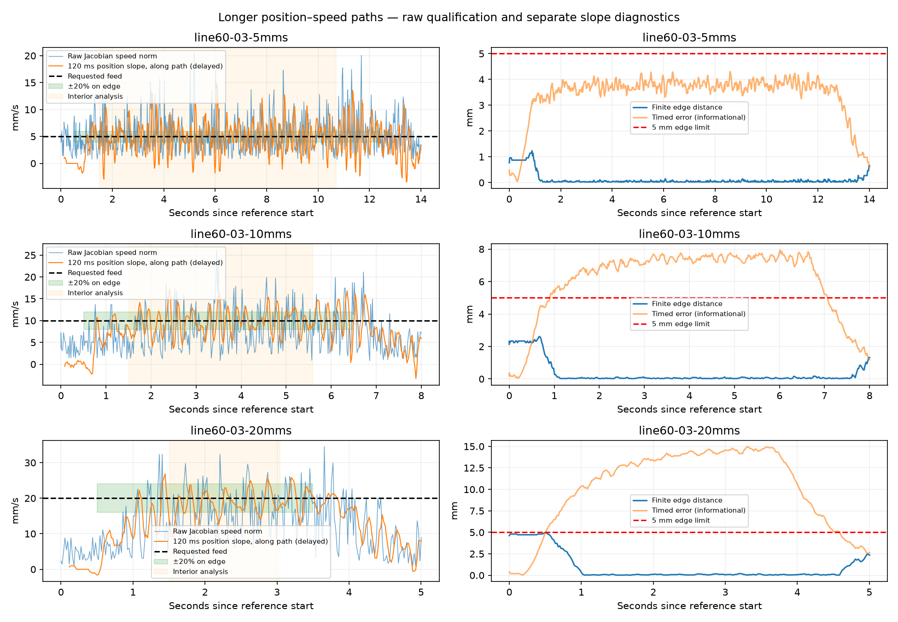

# Higher feed speeds on longer position–speed paths

18 September 2026. Requested test: 10 and 20 mm/s on longer paths, investigating
whether low-speed sticking contributes to inconsistent motion.

**Higher feed improved relative speed consistency overall, but no run met the
full raw ±20% feed requirement.** Eleven tracking runs completed within the 5 mm
finite-edge tolerance; one additional attempt was rejected before tracking.
The arm finished disabled at verified rest, maximum joint error **0.131°**, with
no SDK communication, oscillation or execution-watchdog fault during this session.

## Experiment

Extended the existing 20 mm unconstrained lines to **60 mm**, preserving their
centers and directions. Four directions passed nominal offline preflight at both
requested speeds: fixture IDs 1, 3, 4 and 5 (Y, Z, Y/Z diagonal and X/Y diagonal).
The original pure-X fixture was excluded: 60 mm exceeded the automatic excursion
bound at 10 mm/s, and both 40/60 mm candidates exceeded the 0.15 rad/s joint
reference ceiling at 20 mm/s. No limit was raised to include it.

Test order was four runs at 10 mm/s, four attempts at 20 mm/s, then four matched
5 mm/s runs. All used the same position–speed controller, unchanged onboard gains,
unchanged operator motion limits, friction feedforward off, and the existing
0.15 rad/s commissioning ceiling. Automatic excursions remained strictly below
0.49 rad relative to current, rest and prior targets. Camera checks remained
skipped; monitoring stayed available. All communication went through the SDK app.

Lead-in/out ramps remained 0.5 s: 1.25, 2.5 and 5 mm beyond each edge endpoint at
5, 10 and 20 mm/s. Total reference durations were 13, 7 and 4 s, followed by the
existing one-second final hold. Global finite-edge tolerance stayed 5 mm; timed
position error remained informational. Orientation was unconstrained.

## Matched comparison

The table averages the **three directions completed at every speed**: IDs 1, 3
and 4. Interior analysis starts one second after the constant-feed interval begins
and ends at 85% of the requested edge. This provides approximately 9.2, 4.1 and
1.55 s of interior data at 5, 10 and 20 mm/s. It is a diagnostic window, not a
replacement for qualification over the entire requested edge.

| Requested feed | Interior raw samples within ±20% | Interior position-slope samples within ±20% | Mean position-slope along-path speed | Mean relative raw RMSE |
|---|---:|---:|---:|---:|
| 5 mm/s | 22.5% | 49.4% | 4.94 mm/s | 75.5% |
| 10 mm/s | 36.4% | 73.0% | 9.63 mm/s | 38.7% |
| 20 mm/s | 51.9% | 81.0% | 18.44 mm/s | 29.0% |

Raw speed is the norm of the Jacobian velocity estimate from reported motor
velocities. Position slope is a separate signed along-path estimate over 120 ms,
with delay; it does not replace the raw qualification rule. Neither is external
TCP metrology. Aggregate percentages above are arithmetic means across paths.

Improvement was direction-dependent. On the vertical line, the position-slope
in-band fraction rose from **30.6% → 46.1% → 68.8%**. On the Y/Z diagonal it rose
from **25.2% → 76.0% → 79.2%**. The Y line was already relatively steady by this
measure: **92.6% → 97.1% → 94.8%**. Higher speed did not improve every metric on
every path; raw relative RMSE on the Y/Z diagonal was slightly higher at 20 than
at 10 mm/s.

| Feed | Completed / attempted | Largest global edge distance | Largest timed error | Fully qualified |
|---|---:|---:|---:|---:|
| 5 mm/s | 4 / 4 | 1.252 mm | 4.438 mm | 0 |
| 10 mm/s | 4 / 4 | 2.610 mm | 7.936 mm | 0 |
| 20 mm/s | 3 / 4 | 4.984 mm | 14.969 mm | 0 |

The increasing global edge distance includes the intentional external lead-in/out;
it should not be interpreted entirely as lateral tracking error. Across the three
matched paths, interior edge distance stayed below **0.701 / 0.862 / 1.011 mm**
at 5 / 10 / 20 mm/s. The 20 mm/s lead-in has essentially no margin to the global
5 mm threshold, although all three executed runs completed without a tolerance stop.

The timed lag persists despite longer paths. In the interior, mean timed error
divided by feed was roughly 0.69–0.75 s. This ratio is a descriptive estimate, not
an identified controller delay. Increasing path length lets the speed settle, but
does not eliminate the position lag behind the timed reference.

## Interpretation and remaining limits

The vertical and diagonal position-slope traces are less erratic relative to feed
at the higher speeds. This is consistent with the user's low-speed friction
hypothesis, but does not establish friction as the cause. Fixed feedback
quantization, the firmware cascade and streaming-target lag also affect these
measurements. There was no force identification or onboard gain change in this
experiment.

The fourth 20 mm/s attempt, fixture 5, was rejected during approach-path
validation. Its calculated J2 endpoint was −8.881784197001252e−16 rad, against
the model lower bound −8.88178e−16 rad—a floating-point-scale violation. The
check was retained, and no tracking command was sent for that attempt. This is
not evidence of a physically unreachable path. Exact diagnostic:
[line60-05-20mms-error.json](line60-05-20mms-error.json).

No stages are marked DONE and no new default feed speed is selected.

## Plots and evidence



- [Y-line comparison](line60-01-comparison.png)
- [Y/Z-diagonal comparison](line60-04-comparison.png)
- [X/Y-diagonal, 5 and 10 mm/s](line60-05-comparison.png)
- [Per-run metrics](metrics.json), [matched aggregate](comparison.json),
  [preflight](preflight.json), [run log](run.log),
  [verified-rest status](final-rest-status.json).

Every completed run has `line60-*-*mms.json` metadata, a matching `.jsonl` tracking
trace and a `-control.jsonl` SDK telemetry trace. STEP candidates are in `assets/`.
`preflight.py` recreates the hardware-free candidates and nominal kinematic checks;
the live app additionally checks collision, actual measured seed and automatic
excursions before issuing motion.

Reproduce analysis, with motors disabled:

```sh
MPLCONFIGDIR=/tmp/autoweld-mpl .venv/bin/python -m scripts.analyze_pos_speed_faster
```

The live runner is `python -m scripts.pos_speed_faster`; it requires an already
enabled, healthy POS_VEL session and issues real motion. Do not use it as a
hardware-free test. Production controller/guard code was unchanged in this task.
Ruff passed for the new runner and analysis. Saved motion limits, rest, MIT gains,
gravity settings, friction setting and POS_VEL ceiling match the pre-test state.
