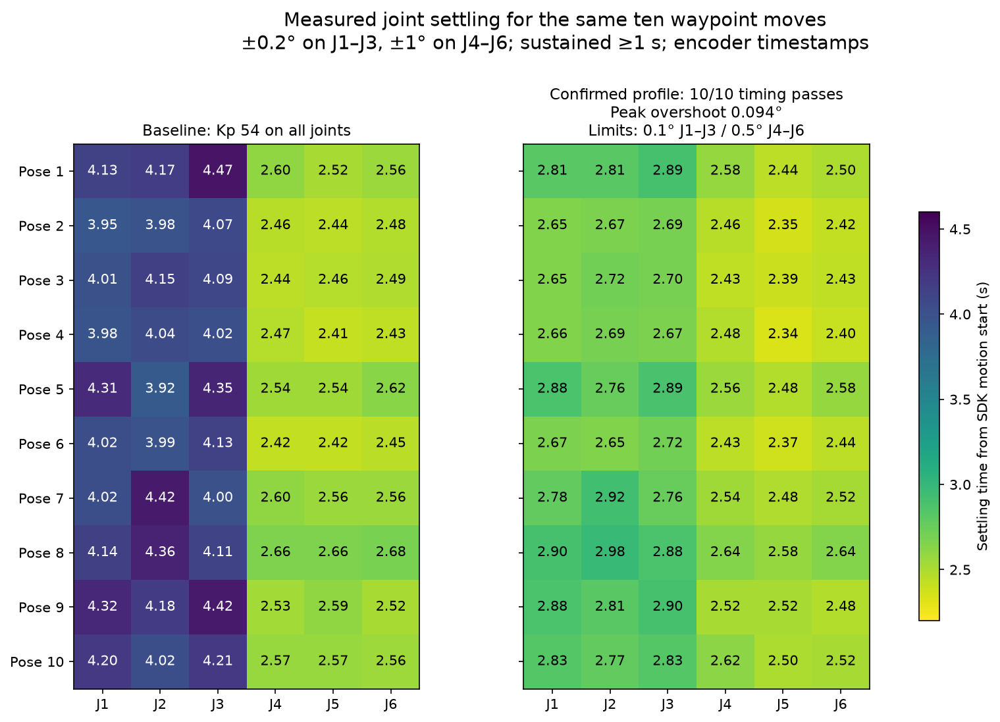
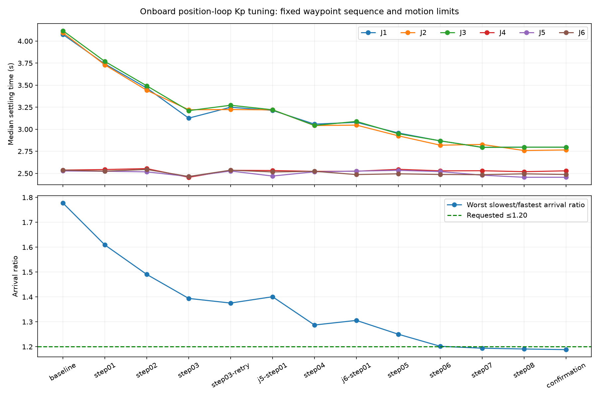

# POS_VEL Kp tuning — ten matched waypoints

**The selected profile passes the ten-pose arrival and revised overshoot criteria.** The same ten distinct poses were run twice at the selected gains: **20/20 measured moves** meet a slowest/fastest arrival ratio ≤1.20. Worst ratio across both runs is **1.19092** (19.09% spread), versus **1.77759** (77.76%) at baseline; the final confirmation’s worst ratio is **1.18835**. Across both selected-profile runs, proximal overshoot is at most **0.02501°** and wrist overshoot **0.11558°**. After reviewing that wrist result, the user explicitly kept the profile and set wrist overshoot tolerance to **0.5°**, retaining **0.1° for J1–J3**. The confirmation’s wrist maximum was **0.09372°**. This is qualification for these bounded encoder-based waypoint tests, not universal precision/path or Stage 1–3 qualification.

This session recorded **121 complete waypoint trials**, plus one executed waypoint with incomplete timing acquisition. All commanded experiments stayed inside the original automatic excursion bounds. No SDK communication, sustained-oscillation or execution-watchdog fault occurred. No Flash save was issued.

[Selected RAM profile](selected-profile.json) · [All 20 selected-profile results](selected-validation.json) · [Full method](METHOD.md) · [Every round](summary.json) · [Fixed poses and preflight](preflight.json)

## Selected profile and final confirmation

Onboard `KP_APR`, J1–J6: **[193.49176, 193.49176, 193.49176, 54, 77.76, 64.8]**. These are actuator position-loop gains, not the host MIT gains. All upward changes were nominal 20% steps, with float32 read-back values archived. J1–J3 progressed 54 → 64.8 → 77.76 → 93.312 → 111.9744 → 134.36928 → 161.243136 → 193.4917632. J4 stayed at 54. J5 comparisons used 54, 64.8 and 77.76; J6 used 54 and 64.8.

Settling means entry into ±0.2° on J1–J3 and ±1° on J4–J6 followed by at least one second continuously inside the band. Times below are seconds from the actual SDK reference start, excluding planning latency. They do not mean zero velocity at that instant. Reference durations are about 3.05–3.37 s; this does **not** qualify the separate one-second convergence aim.

| Pose | J1 (s) | J2 (s) | J3 (s) | J4 (s) | J5 (s) | J6 (s) | Slowest / fastest | Peak overshoot |
|---|---:|---:|---:|---:|---:|---:|---:|---:|
| 1 | 2.813 | 2.813 | 2.895 | 2.575 | 2.436 | 2.498 | 1.188 | 0.013° |
| 2 | 2.653 | 2.673 | 2.694 | 2.456 | 2.353 | 2.416 | 1.145 | 0.063° |
| 3 | 2.653 | 2.715 | 2.695 | 2.433 | 2.394 | 2.433 | 1.134 | 0.008° |
| 4 | 2.657 | 2.693 | 2.674 | 2.476 | 2.337 | 2.399 | 1.152 | 0.045° |
| 5 | 2.878 | 2.757 | 2.893 | 2.559 | 2.475 | 2.579 | 1.169 | 0.023° |
| 6 | 2.672 | 2.652 | 2.715 | 2.434 | 2.375 | 2.435 | 1.144 | 0.041° |
| 7 | 2.780 | 2.923 | 2.762 | 2.541 | 2.483 | 2.523 | 1.177 | 0.063° |
| 8 | 2.902 | 2.982 | 2.883 | 2.642 | 2.581 | 2.643 | 1.155 | 0.025° |
| 9 | 2.876 | 2.812 | 2.897 | 2.516 | 2.517 | 2.477 | 1.169 | 0.077° |
| 10 | 2.832 | 2.774 | 2.833 | 2.616 | 2.496 | 2.517 | 1.135 | 0.094° |

Median J1/J2/J3 settlement improved from **4.075/4.093/4.117 s** to **2.796/2.766/2.797 s** in the confirmation. Wrist medians remained approximately 2.46–2.52 s. This supports the earlier diagnosis that unequal position-loop response, rather than merely different velocity ceilings, was producing much of the proximal lag. It does not establish identical phase response throughout a Cartesian path.

## All rounds, including original rejections

The table retains the criteria applied when each round ran. Early rounds used a uniform 0.1° overshoot ceiling. The user’s later wrist-limit update is recorded in [operator-selection.json](operator-selection.json); `selected-validation.json` reevaluates both selected-profile runs under the accepted per-joint limits without rewriting historical verdicts.

| Round | Recorded poses | Timing passes | Worst arrival ratio | Max overshoot | Result |
|---|---:|---:|---:|---:|---|
| [baseline](baseline/metrics.json) | 10 | 0 | 1.778 | 0.094° | Timing mismatch |
| [step01](step01/metrics.json) | 10 | 0 | 1.609 | 0.094° | Timing mismatch |
| [step02](step02/metrics.json) | 10 | 0 | 1.491 | 0.094° | Timing mismatch |
| [step03](step03/metrics.json) | 3 | 0 | 1.394 | 0.041° | Incomplete acquisition |
| [step03-retry](step03-retry/metrics.json) | 10 | 0 | 1.375 | 0.116° | Overshoot failed |
| [j5-step01](j5-step01/metrics.json) | 9 | 0 | 1.401 | 0.098° | Endpoint start check failed |
| [step04](step04/metrics.json) | 9 | 0 | 1.287 | 0.098° | Endpoint start check failed |
| [j6-step01](j6-step01/metrics.json) | 10 | 0 | 1.306 | 0.094° | Timing mismatch |
| [step05](step05/metrics.json) | 10 | 2 | 1.250 | 0.094° | Timing mismatch |
| [step06](step06/metrics.json) | 10 | 9 | 1.202 | 0.116° | Overshoot failed |
| [step07](step07/metrics.json) | 10 | 10 | 1.194 | 0.116° | Overshoot failed |
| [step08](step08/metrics.json) | 10 | 10 | 1.191 | 0.116° | Overshoot failed |
| [confirmation](confirmation/metrics.json) | 10 | 10 | 1.188 | 0.094° | Pass under revised per-joint limits |

For historical comparison, the best completed ten-pose profile that stayed below the former uniform 0.1° overshoot ceiling was `step05`: **[134.36928, 134.36928, 134.36928, 54, 54, 64.8]**. Its peak overshoot was **0.09372°**, but its worst arrival ratio was **1.25018**, so it misses the requested timing criterion. This is a local measured result, with little overshoot margin; it is not a universal qualification.

## Rejections and observations

- The first 93.312 round encountered an app/SDK publication race after accepting pose 4. The waypoint completed and normal rest disable succeeded, but its timing trace was incomplete. The recorder now waits for a new SDK reference session; the same gain was retested from pose 1. A regression test covers this race.
- Two rounds could not satisfy the runner’s additional matched-start check: all joints within 0.1° for 1.5 s. This is stricter than the wrist settling tolerance and is **not an SDK fault threshold**. Extended logs identified J6 holding variation of about 0.26–0.28° peak-to-peak, not J5. The unchanged SDK guard did not trip. Raising J6 alone from 54 to 64.8 subsequently allowed the full sequence to complete. This comparison supports improvement at the tested poses, not a global stability guarantee.
- The runner originally reused that stricter test-start condition before normal disable. It now allows the app’s original fresh/idle SDK checks and one-second, 0.5° verified-rest policy to govern return/disable. No SDK or production safety threshold changed. The first affected round was manually routed through that existing normal disable and verified rest successfully; the corrected lifecycle has a regression test.
- J5 pose-10 transient overshoot reached the same quantized 0.11558° maximum at tested position gains 54, 64.8 and 77.76. Other joints’ gains differed between some comparisons, so this does not isolate a full causal model. These tested increases did not solve that error; current-loop, speed-loop, integral, acceleration/deceleration and firmware filter settings were not changed.

## Measurement limits and preserved settings

Measurements use per-joint encoder feedback timestamps, deduplicated before analysis. The largest recorded per-joint sample gap was **50.5 ms**; clock-anchor publication spread was at most **10.9 ms**. Times are sampled estimates, not millisecond-accurate metrology. The 16-bit feedback encoding spans ±12.5 rad, a position code step of about **0.02186°**. The distinction between 0.094° and 0.116° is one encoder code; no external metrology establishes true mechanical overshoot below 0.1°. The user explicitly changed the wrist criterion; the original trial verdicts remain archived. The selected-profile timing and overshoot are measured estimates, not a global mechanical guarantee.

All register writes used the SDK with exclusive CAN ownership, app stopped and all seven motors disabled/stationary; independent read-back and unchanged-register comparisons are archived in `register-*.json`. No Flash save, mode/scaling/ID/baud/protection, speed-loop gain, position integral, ACC/DEC/MAX_SPD or TIMEOUT change was made. J4 and the gripper Kp were unchanged. Reported temperatures during the late-round surveys were modest (MOS up to 30°C, rotor up to 32°C).

The 0.15 rad/s POS_VEL ceiling, 0.49 rad automatic excursion limit, joint/collision checks, reference derivative limits, fresh/idle motion-start checks, 100 ms watchdog and one-second oscillation guard remained active. Manual camera checks remained skipped under the standing instruction. No welding trigger was involved. The 10 mm path-deviation recording policy and selected 20 mm/s line / 10 mm/s circle feeds remain unchanged.

**Validation:** 204 hardware-free tests passed, including 12 new tests for gain-step limits, settling measurements, enabled-motor rejection, failed write read-back, reference publication, normal disable and the asymmetric proximal/wrist overshoot limits. Ruff passed on the added scripts/tests. Plots and bulk tests ran with motors disabled.

## Final state

The user-selected gains remain loaded in actuator **RAM**; no Flash save or automatic startup gain-write was added. Final independent SDK survey confirmed the selected values and **all seven motors disabled (0x0)**. Normal disable had verified captured rest at **0.02186° maximum joint error**. The viewer is running at port 8081, Position–speed selected, motors disabled and Enable available; its initial display is explicitly cached until Enable. Motion limits, captured rest/gripper, cached MIT gains, gravity/friction settings and all unrelated surveyed registers are preserved; [settings audit](settings-validation.json), [fresh final register survey](registers-final.json). No stage is marked DONE. RAM reads/writes do not establish or verify persistent Flash settings.

Reproduction: `python -m scripts.pos_speed_kp_trials preflight` is offline; `python -m scripts.plot_pos_speed_kp` regenerates plots while disabled. `pos_speed_kp_registers` and `pos_speed_kp_trials run` issue actual SDK configuration/motion and require the documented disabled/exclusive ownership or live-app conditions. See their CLI help and METHOD.md before reusing them.
