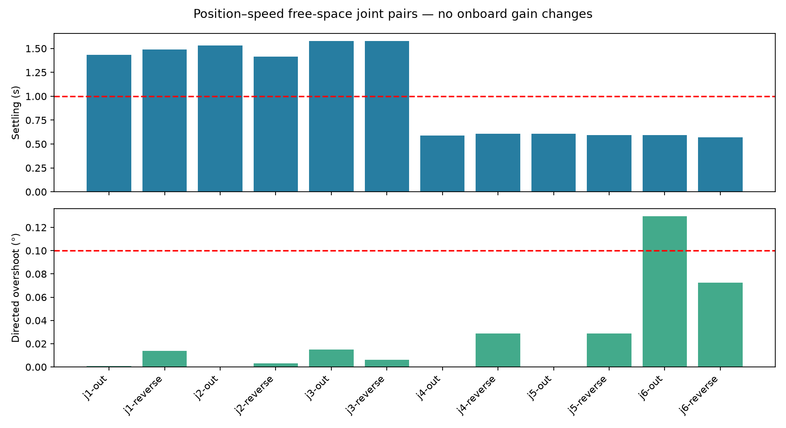
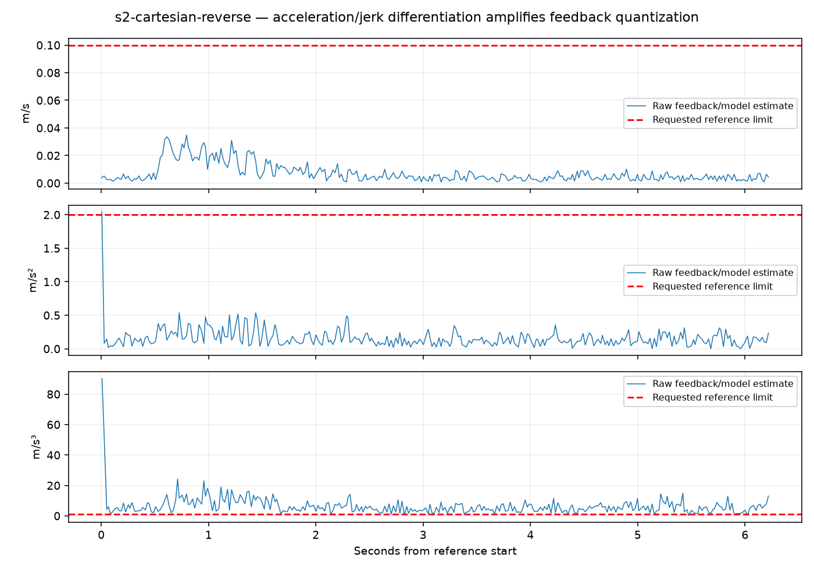
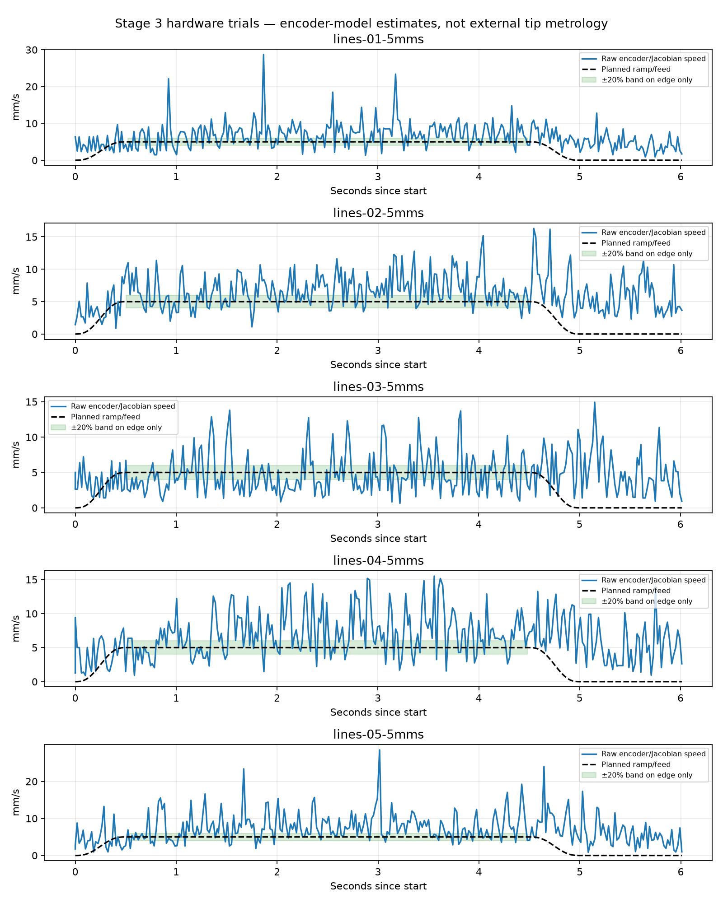

# Position–speed commissioning — 18 September 2026

The new actuator-firmware position–speed controller is implemented and selectable
in Viser. The corrected Stage 1/2/3 repeat improves observed final joint error and
edge following, but **does not qualify the full precision, settling, overshoot and
feed-speed requirements**. No stage is marked DONE.

The arm finished disabled after a one-second rest check at **0.153° maximum joint
error**. A separate SDK survey then confirmed all seven motors report disabled
(`0x0`). The refreshed viewer on port 8081 has Position–speed selected and Enable
motors available. Its startup pose is clearly labeled as a saved rest record,
not live feedback.

## Controller and configuration

See [the mode documentation](../../docs/POS_SPEED.md) for manufacturer references,
protocol details and UI operation. Damiao runs the position, speed and current
loops inside each actuator; the host supplies angle and a positive speed ceiling.
The six arm motors use POS_VEL; the calibrated linear gripper remains in MIT.

All traffic uses the patched i2rt SDK. Switching firmware families requires normal
verified-rest disable, selection, then Enable. Startup surveys every motor before
writing any mode, writes only RAM CTRL_MODE, reads it back and seeds each arm
motor with its measured position before enabling. No Flash write or onboard gain,
acceleration, deceleration or timeout change was made. The SDK now explicitly
disables motors on close instead of relying on communication timeout.

| Actuators | Speed P (KP_ASR) | Speed I (KI_ASR) | Position P (KP_APR) | Position I (KI_APR) |
|---|---:|---:|---:|---:|
| J1–J3, DM4340 | 0.00384 | 0.002 | 54 | 0 |
| J4–J6, DM4310 | 0.00372 | 0.002 | 54 | 0 |

Raw register values ACC=2, DEC=−2, MAX_SPD=600 and TIMEOUT=8000 were preserved.
Compare [before](motor-registers-before.json) and [after](motor-registers-after.json):
the only register differences are CTRL_MODE 1→2 for IDs 1–6; ID 7 is unchanged.
Register numbers are recorded as firmware values, not asserted SI conversions.

Commissioning uses a **0.15 rad/s arm speed ceiling**, also applied to the joint
reference planner. Stricter operator limits still apply. The existing operator
limits and captured rest/gripper record compare equal before and after this work.
The firmware ceiling itself is not proof of a measured physical bound: the raised
approach reported a raw joint-speed peak of 0.159 rad/s.

This protocol has no torque-feedforward field. Host gravity, friction, integral
and MIT quantization compensation are inactive in POS_VEL. Telemetry identifies
motor-reported torque and does not invent separate onboard loop contributions.
The existing MIT profile is retained; source already selected host I=0 before this
task. Normal startup still selects Tuned PD, while this running viewer explicitly
selects Position–speed. Mode selection alone does not enable the motors.

The one-second oscillation guard, 100 ms motion watchdog, joint/collision checks,
automatic excursions below 0.49 rad and normal rest-disable check remain active.
Fault hold stays in the selected firmware mode; there is no energized mode switch.
Camera monitoring remains available; image checks were skipped as instructed.

## Stage 1 — joint positioning

The corrected set comprises one raised free-space approach and twelve individual
outward/reverse moves. The raised offset from captured rest is
`[0.03, 0.10, 0.20, 0.015, 0.015, 0.015]` rad. Individual excursions are 0.015 rad
on J1–J3 and 0.035 rad on J4–J6; the latter exceed the one-degree wrist acceptance
band. All use the existing smooth waypoint executor and configured limits.

Settling is measured from reference start, with every joint continuously inside
its tolerance for at least the final one second of the trace. Directed overshoot
uses the target direction relative to measured pre-move position. Values below
are maximum overshoot across all joints, including coupled motion.

| Joint pair | Outward settling (s) | Reverse settling (s) | Outward overshoot (°) | Reverse overshoot (°) |
|---|---:|---:|---:|---:|
| J1 | 1.434 | 1.490 | 0.001 | 0.014 |
| J2 | 1.533 | 1.414 | 0.000 | 0.003 |
| J3 | 1.577 | 1.577 | 0.015 | 0.006 |
| J4 | 0.589 | 0.608 | 0.000 | 0.029 |
| J5 | 0.607 | 0.592 | 0.000 | 0.029 |
| J6 | 0.592 | 0.569 | **0.130** | 0.073 |

Observed final joint errors were approximately 0.01–0.03°. These are errors against
the actuator feedback, not external measurements of absolute mechanical accuracy.
Position feedback still has roughly 0.0219° quantization across its ±12.5 rad
range. Float32 commands do not improve that measurement resolution.

J1–J3 miss the under-one-second goal. J6 outward fails the strictly-under-0.1°
overshoot requirement. The larger raised approach takes 4.771 s to settle, with a
3.208 s reference duration and 0.037° maximum directed overshoot. Rest contact is
excluded from free-space qualification and was not used to fit forces or gains.

[Machine-readable metrics](metrics.json) and `s1-*.jsonl` contain all traces;
`s1-*.png` plot measured/reference joint errors for every trial.

## Stage 2 — velocity, acceleration and jerk

One combined joint waypoint and a Cartesian outward/reverse pair completed.
All sampled planned derivatives stayed below their configured reference limits;
the shared IK, seventh-degree time scaling and TCP/Jacobian checks remain active.

| Trial | Reference duration (s) | Settling from start (s) | Directed overshoot (°) | Raw TCP speed peak (mm/s) |
|---|---:|---:|---:|---:|
| Combined joint | 0.904 | 2.033 | 0.054 | 22.9 |
| Cartesian outward | 0.966 | 2.283 | 0.008 | 17.7 |
| Cartesian reverse | 1.173 | 2.683 | 0.094 | 34.8 |

The operator's reference caps remain 100 mm/s, 2 m/s² and 1 m/s³ for TCP
translation. These three raw TCP speed peaks are below that speed cap, but this
does not qualify all physical derivatives. Differentiated raw velocity gives
acceleration peaks of 0.665/0.521/2.042 m/s² and jerk peaks of
23.4/22.5/90.2 m/s³. Differentiation strongly amplifies velocity quantization and
timing noise. Neither those estimates nor the bounded reference establish
compliant physical acceleration/jerk. Firmware interpolation and the existing
onboard cascade still affect tracking.

All Stage 2 traces and position/derivative plots are named `s2-*`.

## Stage 3 — STEP edge tracking

All twenty existing fixtures were attempted at 5 mm/s: five 20 mm lines, five
12.7 mm radius circles, five perpendicular lines and five center-facing quarter
arcs. Seven were rejected in preflight; thirteen tracking paths were sent and
completed with verified final holds. **All thirteen stayed within the finite-edge
5 mm tolerance; none qualified on raw feed speed within ±20%.**

| Suite | Completed / attempted | Maximum edge distance (mm) | Maximum constrained orientation error (°) | Worst raw feed error (%) | Fully qualified |
|---|---:|---:|---:|---:|---:|
| Unconstrained lines | 5 / 5 | 1.298 | — | 473.4 | 0 |
| Unconstrained circles | 3 / 5 | 1.485 | — | 327.6 | 0 |
| Perpendicular lines | 5 / 5 | 4.360 | 2.463 | 447.6 | 0 |
| Center-facing quarter arcs | 0 / 5 | — | — | — | 0 |

Circle 1 and 2 preflights exceeded model joint bounds at 41.2% and 49.8% of their
paths. All five center-facing arc IK searches failed at 44.4% of the extended
path, with candidate J4 at its model upper bound, 1.5708 rad. These local search
failures do not prove the geometric targets unreachable. No rejected arc/circle
tracking command was sent; no safeguards were relaxed to execute them.

Timed position error reached 11.631 mm on a perpendicular line and remained
informational, as requested. Finite-edge distance controlled the stop criterion.
There were no position-guard stops in the corrected repeat.

Raw speed is the Jacobian estimate from reported joint velocity. It is quantized
and is not external TCP metrology, but the stipulated raw-speed qualification was
not replaced with a smoothed estimate. The traces show substantial variation;
better final holding error alone has not solved feed regulation.

Plots: [circle speed](stage3/circles-raw-speed.png),
[perpendicular-line speed](stage3/perpendicular-lines-raw-speed.png),
[line tracking](stage3/lines-tracking.png),
[circle tracking](stage3/circles-tracking.png),
[perpendicular-line tracking](stage3/perpendicular-lines-tracking.png).
[Summary and exact preflight errors](stage3/summary.json); full results/traces are
in `stage3/*-5mms.json` and `stage3/*-5mms.jsonl`.

These results cover the current fixtures and nearby poses. They do not establish
global precision or a controlled statistical comparison with historical MIT
trials. The next unresolved controller work is onboard cascade/feed regulation;
the next geometric work is finding valid constrained arc paths. No onboard
retuning was performed in this commissioning repeat.

## Initial incident and corrected repeat

Initial testing exposed a startup-cache bug: SimRobot clipped the saved normalized
gripper value 0.98558 against raw motor-angle calibration limits, producing a
0.25998 target. This unintentionally changed the commanded gripper position.
The simulator now clips normalized gripper values to [0,1], preserving the SDK
mapping, and a regression test covers the original calibration.

During the initial fourth line approach the SDK's 100 ms execution watchdog
latched a hold. Host CPU work was running concurrently; the timing gap is recorded,
but its cause is not conclusively isolated. The fresh quiet-window recovery check
passed, followed by a normal verified-rest disable at 0.153°. The guard threshold
was unchanged. Bulk tests and plotting were moved after hardware disable.

Those initial measurements are preserved in
[initial-gripper-cache](initial-gripper-cache/README.md) and excluded from the
primary figures above. The original rest/gripper record was restored, the correct
gripper target was established at supported rest, and all three stages were
repeated. The corrected primary run had no SDK communication, oscillation or
execution-watchdog faults. The old MIT session also needed repeated rest checks
before switching; no failed rest check was bypassed.

## Verification and final state

- 172 hardware-free tests pass, including mixed-mode encoding, sign handling,
  measured seeding before enable, partial-start cleanup, RAM readback failure,
  disabled-only mode switching, feedforward exclusion, planner limits and the
  gripper-cache regression. Original SDK PD behavior remains unchanged.
- Ruff passes. The rebuilt SDK patch applies to the pinned pristine source and
  reproduces every modified/added SDK file exactly.
- Browser inspection confirms Position–speed selected, MIT-only controls disabled,
  saved-feedback labeling and Enable motors available. No motor command was sent
  during that UI check.
- [Final tested rest](final-tested-rest-status.json) records the actual 0.153°
  rest verification. [Post-close motor survey](motor-registers-after.json) confirms
  all seven disabled. [Deployment status](final-deployment-status.json) records
  the restarted, disabled viewer; it deliberately does not claim fresh feedback
  or a new rest verification.

Reproduce hardware-free plots with `python -m scripts.analyze_pos_speed` and the
existing `scripts.plot_tracking` module. The authorized live runner is
`python -m scripts.pos_speed_suite --stage 1` (then 2 and 3), requiring an already
enabled healthy POS_VEL session. These commands issue physical motion; they are
not part of the hardware-free test suite.
