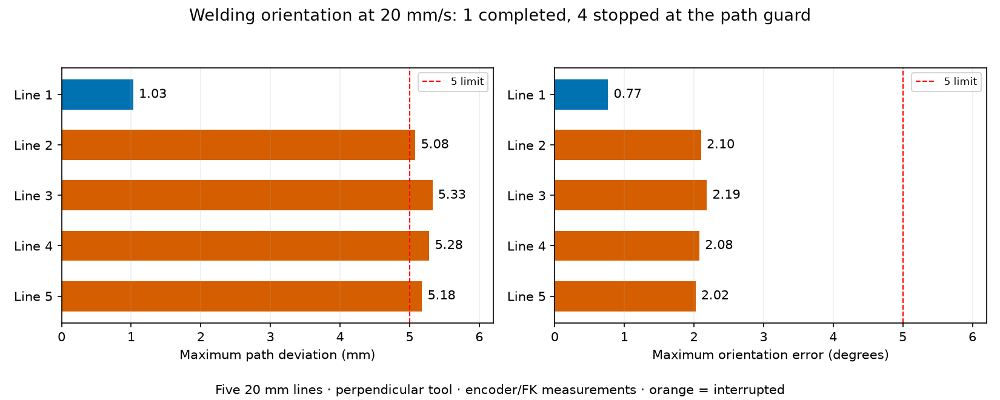
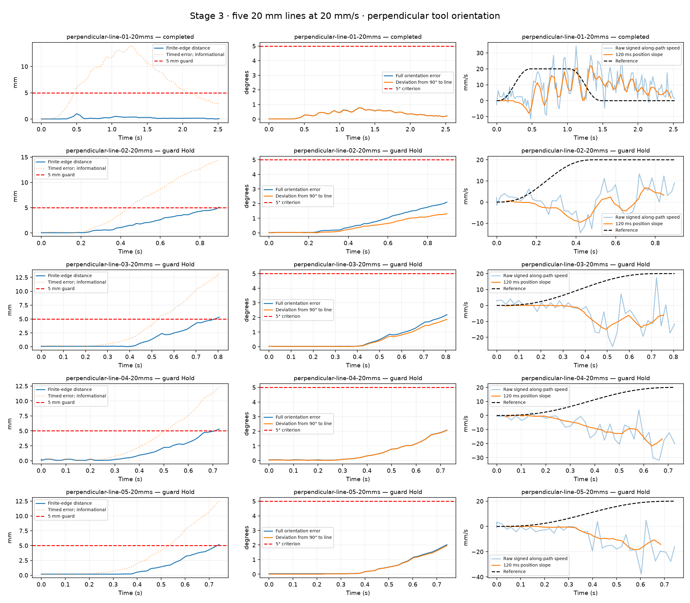

# Stage 3 welding-orientation tests at selected safe feeds

The operator selected **20 mm/s for straight lines** and **10 mm/s for circles/arcs** on 2026-09-20. These are now persistent Stage 3 presets in source and are displayed in the UI. Loading a STEP chooses the first edge's preset; **Use selected safe speed** applies the chosen edge's value, clears the old preview and issues no motion. The runtime status also exposes `selected_safe_feed_mm_s`. [Preset scope](../../docs/SELECTED_SAFE_SPEEDS.md).

**The requested welding-orientation tests did not qualify Stage 3.** Five 20 mm perpendicular lines were run at 20 mm/s: one completed and four stopped at the finite-edge guard. The five original center-facing 12.7 mm-radius quarter-arcs failed IK at 10 mm/s. Additional offline placement searches found no arc satisfying all current checks, so **no oriented arc was sent to the motors**. These selected feeds must not be described as universally validated safe speeds for constrained welding motion.



## Perpendicular 20 mm lines at 20 mm/s

The tool's −Z direction was constrained perpendicular to each line (90°), using the existing full-pose solver and orientation guard. Each fixture is placed in robot-base coordinates around a distinct free-space seed. All five passed IK, interpolated joint/collision, automatic excursion, derivative and approach/return preflight. Inside-edge ramps retain the finite requested geometry.

| Line | Outcome | Max finite-edge deviation (mm) | Max orientation error, entire recorded trace (°) | Max deviation from perpendicular (°) | Max timed error (mm) |
|---|---|---:|---:|---:|---:|
| 1 | Completed | 1.030 | 0.766 | 0.759 | 13.883 |
| 2 | 5 mm guard Hold | 5.082 | 2.103 | 1.311 | 14.467 |
| 3 | 5 mm guard Hold | 5.328 | 2.186 | 1.868 | 13.175 |
| 4 | 5 mm guard Hold | 5.283 | 2.079 | 2.064 | 12.269 |
| 5 | 5 mm guard Hold | 5.178 | 2.022 | 1.955 | 12.491 |

Orientation stayed below 5° throughout every recorded trial; the four stops were caused by position deviation, not orientation. Timed error remained informational. The legacy summary only computes its orientation maximum on the constant-feed interval; lines 4 and 5 stopped during acceleration, so their summary value is null. The table above explicitly evaluates every recorded orientation sample instead.

The measured TCP initially moved opposite the requested along-line direction in several fixtures. Maximum negative progress from the requested start was **1.02, 1.74, 4.14, 5.22 and 5.12 mm** for lines 1–5. The speed charts therefore use **signed along-path raw and position-derived velocity**, making the reversal visible. Raw speed magnitude alone can conceal this problem. Different joint response rates while maintaining orientation are a possible explanation, not an identified root cause; no gains or actuator parameters were changed.

None qualified on the unchanged raw ±20% feed criterion. The short 20 mm paths also provide limited constant-feed time: a reference speed setting is not evidence of sustained physical cruising. There were no invalid velocity snapshots in these five traces, but the existing conservative summary still flags duplicate initial elapsed=0 rows. This does not explain the millimetre path failures. No stage is marked DONE.



[3D measured paths and tool direction](tool-orientation.png) · [Numeric metrics](metrics.json) · [Five exact STEP fixtures and preflight](preflight.json)

## Center-facing quarter-arcs at 10 mm/s

The Stage 3 specification is a **12.7 mm radius, 90° arc** with the tool pointing toward the circle center throughout motion. A path-normal tool axis on a small-radius arc imposes substantially different kinematics from the earlier 60 mm-radius unconstrained circle. The configured TCP is still the uncalibrated 150 mm tool placeholder.

- All five original fixtures failed full-pose IK at **42.5–45%** of the planned quarter-arc. Exact residuals are in [original-arcs.json](original-arcs.json).
- A further **54 bounded placement/orientation attempts** found no accepted arc within the existing automatic excursion margin. They failed IK or the excursion check; [arc-search.json](arc-search.json).
- An additional **96 offline wider-pose attempts**, including a 0.65 rad wrist offset in half, explored whether a feasible reviewable alternative existed. Some passed sampled IK, but none passed the complete 10 mm/s plan with unchanged derivative/interpolation checks. Minimum excursion among sampled-IK candidates was 1.819 rad, already beyond the live 0.49 rad automatic bound. Many complete planning attempts ended with insufficient ramp length; one recorded interpolation residual rejection also occurred. [Wrist-near-zero search](expanded-arc-search-wrist0.json), [offset-wrist search](expanded-arc-search.json).
- These searches were **offline only**. No live joint bound, motion limit or automatic excursion guard was increased. Local IK failures do not prove global unreachability; the search did not establish a qualifying executable arc at the selected settings.

Center-facing arc validation therefore remains outstanding. A different feasible geometry/orientation strategy or separately approved limits/feed change would need complete preflight before any such live motion. The present evidence does not justify bypassing the checks or claiming the five arc tests completed.

## Start rejection, recovery and final state

The prior viewer was no longer running when this session began. Its cached status was not treated as fresh feedback. The unanswered shutdown request was archived, then the viewer restarted with motors disabled; the 10 mm/s arc preset was checked without issuing motion before explicit enable for the authorized tests.

The first line approach was rejected after path validation because measured speed exceeded the existing 0.05 rad/s idle-start threshold. No tracking run began. Normal verified-rest disable succeeded. That attempt is preserved in [start-rejection](start-rejection/run.log). A subsequent retry used a two-second settling hold in the test runner; the SDK threshold and watchdog were unchanged. After line 2 stopped, the arm returned to verified rest before the remaining three independently preflighted fixtures were tested.

Final normal disable verified rest at **0.131° maximum joint error**, with the one-second rest check. Motors remain **disabled**, Position–speed selected, joint ceiling restored to **0.15 rad/s**, automatic excursion **0.49 rad**, friction off. No SDK communication, oscillation or execution-watchdog fault occurred. Saved rest/gripper, host gains/gravity and operator motion limits match the pre-session record. No onboard gain, ACC/DEC, TIMEOUT or Flash writes were made.

190 hardware-free tests passed after the preset implementation; 25 affected tracking tests passed following the status addition. Ruff passes for all source, scripts and tests. No SDK implementation changes were needed; plotting/tests and expanded IK searches ran with motors disabled. Measurements are encoder/FK estimates, not external TCP metrology or welding qualification.

[Final rest status](final-rest-status.json) · [Validation and preserved settings](validation.json) · [Selected safe speeds](../../docs/SELECTED_SAFE_SPEEDS.md)

Offline plot reproduction:

```bash
MPLCONFIGDIR=/tmp/autoweld-mpl .venv/bin/python -m scripts.plot_stage3_welding
```

The archived live runner records this explicitly authorized session; it does not authorize broader future excursions.
