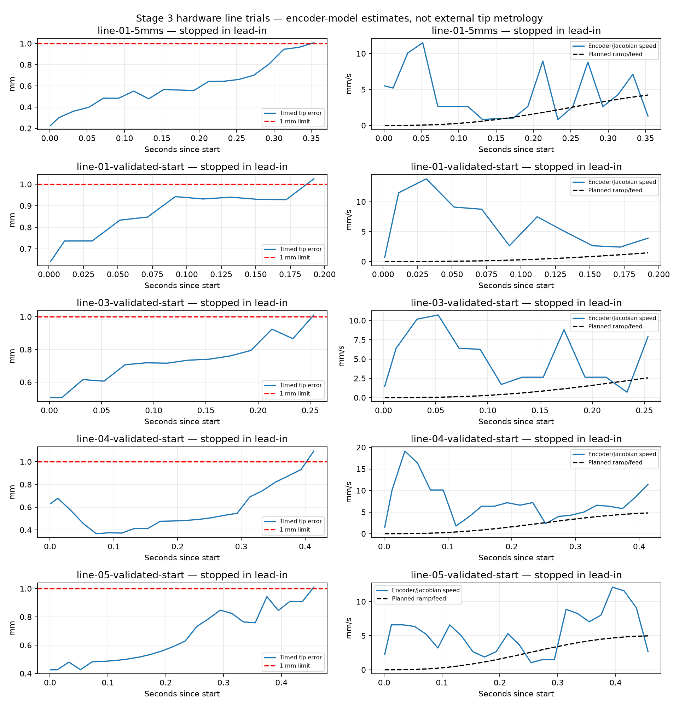

# Stage 3 implementation and commissioning — 2026-09-16

Path tracking is implemented. **Hardware tracking is not qualified and Stage 3 is not DONE.**
The five-location line commissioning gate did not pass, so no live circle or constrained-orientation
trials were executed. The user explicitly authorized starting Stage 3.

## Implemented behavior

- Import actual STEP straight/circular wire edges in robot-base coordinates and display them in Viser.
  Five 20 mm lines, five 12.7 mm-radius circles, and five quarter-circles are in `assets/stage3/`.
- Preview, explicit planned approach, and explicit run. Full path preflight includes lead-in/out,
  IK, sampled joint bounds, self-collision, interpolation residual and TCP/joint derivative limits.
- A separate SDK `FeedJointPath` preserves the selected feed through the requested edge, with smooth
  acceleration/deceleration on displayed extensions. Typical 5 mm/s line: 0.5 s ramps, 1.25 mm
  extension on each end, 5 s reference duration. References include q/v/a/jerk; motors receive q/v.
- Unconstrained orientation holds the starting orientation and does not grade it. Perpendicular
  straight-line and center-facing circular orientation are implemented and geometrically tested.
- Encoder-FK timed position error, finite-edge contour error, orientation and Jacobian speed are logged.
  A measured position error >=1 mm triggers Hold; constrained on-edge orientation above 5° also stops.
  Completion includes a one-second final hold. Qualification additionally requires complete on-edge
  coverage, <=100 ms sampling gaps, and every on-edge raw speed sample within ±20% of requested feed.
- SDK communication only. All automatic test path points, including lead extensions, remain inside
  the <0.49 rad envelope. No P/I/D gains, integral reset/deadband policy, gravity factors or friction
  settings were changed. Original PD function was checked byte-for-byte against pinned SDK source.
  The reproducible SDK patch includes the new timing class and preserves it in the SDK executor.

## Mathematical and offline checks

135 tests passed, plus Ruff. Tests cover feed timing and finite-difference derivatives, zero v/a/jerk
at rest endpoints, SDK cloning/execution routing, real STEP geometry and unit conversion, constant
reference speed, pose residuals, orientation geometry, qualification rules, automatic-test limits,
and fixed-gripper handling despite encoder noise. The patch reproduces the pinned SDK modifications.

All five lines, five circles and five quarter-arcs preflighted offline with unconstrained orientation
at 5 mm/s under default reference derivative limits (`offline-preflight.json`). These checks are not
physical qualification and do not establish collision clearance at arbitrary placements. A complete
line approach/run through the offline app passed (`offline-smoke.json`, `offline-smoke.jsonl`).
The simulator follows references ideally; its tiny numerical errors are not hardware accuracy.

## Live line trials

All fixtures were loaded from STEP into the running viewer. Trials used the selected friction-off
PID/linear-gravity configuration and the user's saved motion limits. The first 5 mm/s line stopped
at 1.007 mm during lead-in. An initial overly conservative start gate prevented other runs; it was
aligned with the Stage 3 requirement (<1 mm), while the runner uses a 0.8 mm margin and <0.005 rad
joint error maintained for 0.7 s, with a 25 s wait. The final five-location outcomes were:

| Line | Result at 5 mm/s | Maximum recorded tip error before Hold |
|---|---|---:|
| 1 | Stopped in lead-in | 1.025 mm |
| 2 | Approach did not sustain runner's start margin; final reported error 0.999 mm | Not run |
| 3 | Stopped in lead-in | 1.011 mm |
| 4 | Stopped in lead-in | 1.094 mm |
| 5 | Stopped in lead-in | 1.010 mm |

Records are `line-*-validated-start.json` / `.jsonl`, with `-error.json` for approach rejections.
No final trial reached the constant-feed section, so its ±20% speed requirement was **not assessed**,
not passed. Orientation was unconstrained and not qualified. A 2 mm/s retry of line 1 also failed to
settle at the approach (last reported 1.491 mm), so slowing feed has not been validated as a remedy.
Earlier attempts and runner/preflight failures are retained separately; not every `-error.json`
indicates a robot fault. No SDK communication or oscillation fault occurred in this session.

The plot compares time-aligned encoder-FK error and measured speed with the planned ramp. The feed
band only applies to on-edge samples; the shown halted traces do not reach that section. Position
errors above 1 mm are recorded threshold crossings, not a claim that the stop can enforce a perfect
continuous-time 1 mm physical bound.

## Limits and next work

The failure occurs during startup/holding, before steady feed. Existing holding torque disappears
when I resets for a new path (as required), while residual gravity/load errors and the integral
deadband can leave sub-mm to mm stationary error. These are plausible contributors, not isolated
causes established by these trials. Investigate the start transient and residual holding torque at
these free-space poses before raising gains or moving to arcs. Preserve friction off and the
one-second SDK oscillation guard; P/D tuning remains bounded to 20% changes if undertaken.

Absolute physical tip accuracy is unverified: measurements use joint feedback and the nominal model;
the placeholder torch TCP and robot-to-workpiece registration have no external calibration. A measured
encoder-model pass alone cannot establish global physical accuracy below 1 mm.

After the line gate qualifies, proceed to the five circles, then perpendicular-line orientation and
center-facing quarter-arcs at reachable placements. The viewer remains available; the session ends
with normal verified-rest motor disable. Final status is in `final-status.json`.
