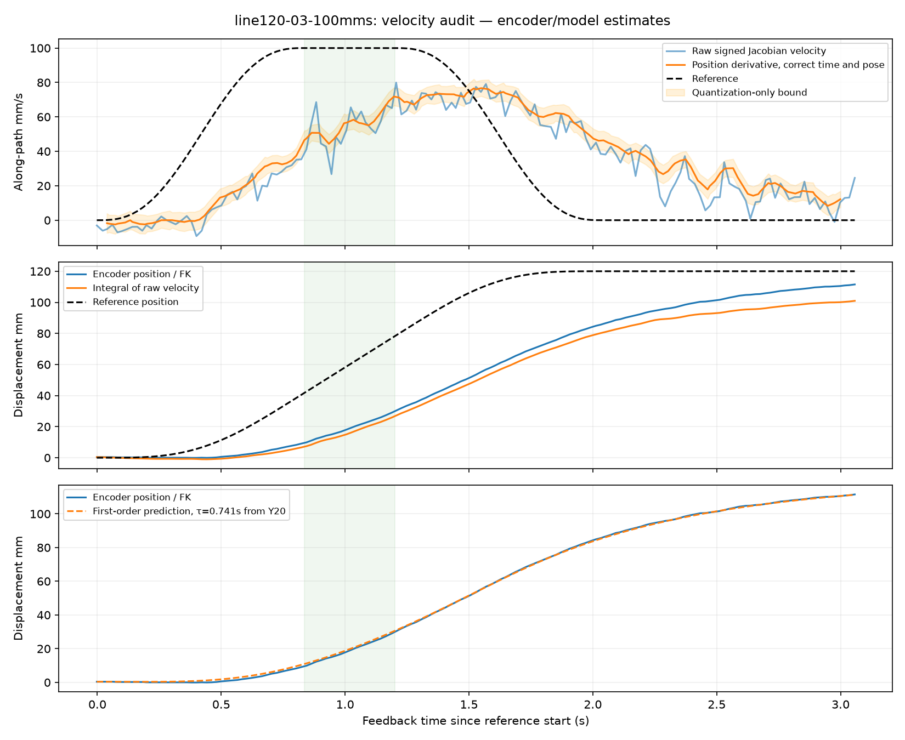

# Velocity measurement and POS_VEL lag audit

The saved 20-run speed sweep contains **both measurement error and real tracking
lag**. Correcting the measurement timing raises the measured average during the
100 mm/s reference plateau from the previously quoted roughly 51 mm/s to about
55 mm/s. It does not explain away the shortfall to 100 mm/s.

The corrected position-derived **segment averages** agree with independently
calculated distance/time averages within 0.516 mm/s across all 20 runs. This is
an internal consistency check using the same encoders, not a claim of sub-mm/s
instantaneous accuracy or externally calibrated TCP accuracy.

No real motion, enable command, motor tuning or firmware change was issued in
this audit. The viewer was refreshed while disabled and POS_VEL reselected.

## What was wrong with the measurements

1. **Raw velocity has a systematic offset.** The recorded onboard VMAX settings
   match SDK decoding: ±10 rad/s on J1–J3 and ±30 rad/s on J4–J6, represented by
   12 bits. One step is therefore 0.004884 and 0.014652 rad/s respectively. A code
   adjacent to zero does not decode to zero. Integrated raw velocity minus actual
   encoder displacement gives these mean joint biases across the runs:

   | Joint | Measured mean bias (rad/s) | Negative half encoding step (rad/s) |
   |---|---:|---:|
   | J1 | -0.002452 | -0.002442 |
   | J2 | -0.002486 | -0.002442 |
   | J3 | -0.002506 | -0.002442 |
   | J4 | -0.007346 | -0.007326 |
   | J5 | -0.007387 | -0.007326 |
   | J6 | -0.007283 | -0.007326 |

   This closely matches truncation to the lower edge of each encoding bin. The
   TCP consequence depends on pose and direction: raw velocity integrated over
   a run disagreed with FK displacement by up to 18.856 mm. A diagnostic half-bin
   correction reduced the worst discrepancy to 4.160 mm but did not eliminate
   noise, sampling effects or aliasing. That candidate correction was **not**
   installed in the SDK or substituted for safety/qualification feedback.
   Position-derived velocity avoids this raw velocity-code bias.
2. **The diagnostic was assigned the wrong time and pose.** The old trailing
   120 ms position slope described motion roughly 60 ms in the past, but it used
   the current Jacobian and the current reference's cruise mask. This understated
   speed during acceleration and compared different physical intervals. The
   estimator now fits a local quadratic using each joint's receive timestamps,
   evaluates all six joint positions and velocities at a common window-center
   time, and uses that fitted pose for the TCP Jacobian. Its reference velocity,
   path tangent and cruise membership are evaluated at its own time.
3. **Not every poll is a usable measurement.** Some historical snapshots had
   feedback ages approaching 90 ms or inter-joint skew up to 60 ms. Cached reads
   are not new samples. The monitor now explicitly marks stale (>50 ms),
   inter-joint-skewed (>10 ms), duplicated or backward-timestamp snapshots invalid
   for speed qualification. Invalid data do not become zero-speed observations.
   The estimator resets after stale data, excessive skew, gaps or backwards time.

The UI now reports the position estimate's reference speed at the matching time,
its timestamp and a quantization-only uncertainty bound. Raw speed remains visible
and unchanged; the existing raw ±20% criterion was not replaced with a filtered
pass criterion. No historical run was promoted to a pass.

## Cross-checks and corrected numbers

The audit reconstructs all six joint positions at common observed timestamps by
interpolation, computes FK and projects displacement along the line. It divides
the displacement between the exact reference cruise boundaries by their elapsed
time. Separately, it integrates the timestamp-aligned fitted velocity over those
same boundaries. No fitted-velocity extrapolation is needed for these runs.

| Requested (mm/s) | Distance/time average during reference cruise (mm/s) |
|---:|---:|
| 20 | 18.07–18.15 |
| 30 | 25.56–25.66 |
| 40 | 31.88–32.17 |
| 50 | 37.32–37.98 |
| 60 | 42.09–42.73 |
| 80 | 49.20–50.19 |
| 100 | 54.77–55.83 |

These are **whole-cruise averages**, including the robot's convergence, unlike
the prior report's separate late-half averages. The 100 mm/s reference plateau
is only 0.363 s. Its two distance/time estimates have first-order encoder
quantization-only bounds of approximately ±1.04 and ±1.06 mm/s; those bounds do
not cover timing calibration, interpolation, compliance or the uncalibrated TCP.
Corrected full-trace position-velocity peaks remain 75.16–76.70 mm/s.

The actual TCP Jacobian was checked against central finite differences of FK at
50 independent poses. Maximum component difference was 1.96e-10 m/rad. There is
no evidence here of an mm/m conversion error, radians/degrees error, extra gear
ratio in velocity decoding, or incorrect Jacobian frame. Saved register survey
and SDK constants agree. The Jacobian's world-space convention also agrees with
the [MuJoCo API documentation](https://mujoco.readthedocs.io/en/3.2.5/APIreference/APIfunctions.html#mj-jacsite).

## Dominant tracking problem

The encoder positions closely follow the first-order relation

`dx/dt ≈ (x_reference − x) / τ`, with fitted `τ = 0.728–0.744 seconds`.

A single τ=0.740882 s fitted only to the Y/20 mm/s run predicts the other 19
position traces with RMS error no greater than 0.639 mm. This prediction uses
their reference positions and initial measured position, not their measured
velocities. It explains the large lag without requiring a velocity scaling error
or a friction threshold. At a sustained 20 mm/s reference, this model predicts
about 14.8 mm of following error, matching the observed approximately 15 mm.

The saved J1–J3 registers contain position gain KP_APR=54 and gear ratio Gr=40;
40/54=0.740741 s closely matches the measured time constant. This is supporting
evidence for the onboard position-loop response, **not confirmation of the
undocumented firmware's internal gain/unit conversion**. Establishing that
causally would require a controlled onboard-gain comparison.

POS_VEL's host speed field is a ceiling, not signed velocity feedforward. Raising
the ceiling does not remove the position loop's need to build following error
to produce velocity. The manufacturer's manual describes the cascaded loops and
slower response in this mode:
[Damiao DM-J4340 manual](https://damiao.enactic.ai/en/products/hardware/dm-j4340-2ec-v1.0/#position-speed-mode).
The evidence points to position-loop response as the next control issue to address;
low-speed sticking is not established as the dominant cause in these runs.

The plots distinguish raw velocity, correctly timed position derivatives,
integrated displacement and the first-order prediction. Additional examples:
[20 mm/s Y](line120-01-20mms.png), [100 mm/s diagonal](line120-04-100mms.png).

## Validation and limits

- **183 tests passed**, including irregular/skewed timestamps, accelerating
  trajectories, quantization bounds, stationary positions, matched reference
  time and pose, invalid-sample rejection and FK/Jacobian consistency. Ruff passed.
- Actual offline viewer runs at 20 and 100 mm/s completed with valid JSON/UI
  reporting. The estimator produced 370 and 148 timestamped estimates. These
  are simulated runs, not new hardware measurements.
- The displayed uncertainty is a first-order **position-quantization-only**
  bound. The 120 ms fit is delayed and suppresses faster changes; it is not a
  high-bandwidth instantaneous measurement. Receive timestamps are host CAN
  timestamps, not independently calibrated actuator acquisition times.
- Both cross-checks share the robot encoders and assumed 150 mm TCP geometry.
  External calibrated tip metrology is still required to certify physical TCP
  speed independently of encoder/kinematic errors.
- The normal raw SDK feedback, oscillation/watchdog thresholds, firmware settings
  and motion controller are unchanged. The arm remains disabled. Its last live
  rest verification was 0.153°; the refreshed disabled viewer correctly labels
  its displayed pose as cached saved-rest data, not fresh feedback.

Reproduce without hardware: `python -m scripts.audit_velocity`. Saved inputs are
in `evidence/pos-speed-100/`; outputs are [metrics.json](metrics.json),
[tests.log](tests.log), [offline-results.json](offline-results.json) and
[final-status.json](final-status.json). No historical trace or metrics files were
rewritten; the prior report links to this correction.
