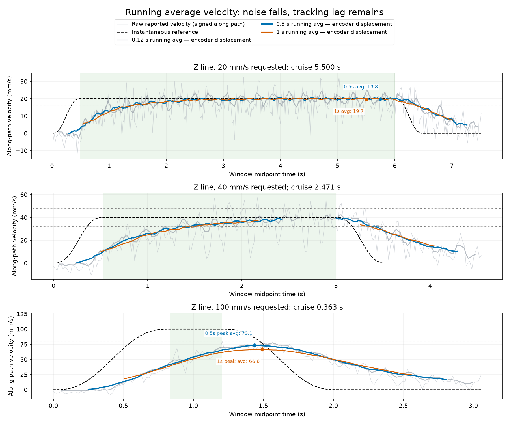

# Running-average velocity with larger windows

Replotted all 20 saved 120 mm POS_VEL line runs using **0.5 s and 1 s running
averages**, with a 0.12 s running average for comparison. The longer windows make
steady motion much clearer. At 20 and 30 mm/s the late averages closely approach
the command; the higher feeds still show real convergence lag within the available
path length. No robot commands were issued and no controller settings changed.

## How speed is measured

The raw estimate is `v_TCP = J(q) × joint_velocity`: motor-reported angular
velocities in rad/s pass through the SDK model's TCP Jacobian to produce m/s.
Those velocity fields are coarse 12-bit values and have the half-step bias
identified in the [preceding audit](../velocity-audit/REPORT.md). Averaging them
reduces fluctuation but does not remove bias.

The primary running average in the new charts instead uses timestamped **encoder
positions**. All six joint positions are aligned to common receive times, forward
kinematics gives TCP position, and displacement is projected along the straight
line. For a window of length W:

`average velocity = [along-path position(t) − along-path position(t − W)] / W`

This is the physical-time average signed velocity, not an average of noisy speed
magnitudes. The same formula is applied to reference positions over the **identical
interval**. Raw-velocity averages are time-weighted integrals, not sample-count
means, because the samples are not perfectly equally spaced.

All complete windows are plotted at their midpoints. In live operation a 0.5 s
window's value becomes available 0.25 s after that plotted time; a 1 s window adds
0.5 s. Longer windows smooth short changes and lower apparent peaks, so the
individual charts also show the command averaged over the identical window.

These are new **boxcar running averages**, distinct from the existing viewer's
120 ms quadratic derivative estimate. The live diagnostic window and the raw
±20% qualification rule were not changed by this plotting analysis.

## Does the running average agree with the command?

The table uses the **final complete window entirely inside the reference's
constant-speed section**, one value per direction. It excludes acceleration,
deceleration and windows containing rejected feedback timing. This tests the
late response, not the complete path's acceptance.

| Command (mm/s) | Last 0.5 s average (mm/s) | Last 1 s average (mm/s) | Reference cruise duration |
|---:|---:|---:|---:|
| 20 | 19.78–20.09 | 19.70–20.03 | 5.500 s |
| 30 | 28.27–30.24 | 29.28–29.85 | 3.500 s |
| 40 | 38.47–39.34* | 37.65–37.83* | 2.471 s |
| 50 | 45.27–46.52 | 43.30–44.32 | 1.808 s |
| 60 | 50.48–51.47 | 46.80–47.36 | 1.352 s |
| 80 | 53.85–56.31 | No full 1 s cruise window | 0.752 s |
| 100 | No full 0.5 s cruise window | No full 1 s cruise window | 0.363 s |

*Two valid directions at 40 mm/s: a feedback timing interruption invalidates the
final Z windows, which are left blank in that chart instead of silently bridged.

Thus **yes at 20–30 mm/s after convergence**, increasingly less so at the higher
feeds within these short paths. The 60 mm/s final 0.5 s window is faster than its
final 1 s window because the arm was still accelerating. A 100 mm/s command does
not have enough constant-speed duration for either larger window. Its full-trace
running-average peaks are marked separately as peaks; they are not steady
100 mm/s measurements. Across the two 100 mm/s runs, the 0.5 s peak averages
are 71.94–73.08 mm/s and the 1 s peak averages are 66.42–66.60 mm/s.

Noise/quantization accounts for a substantial part of the fine fluctuation, but
smoothing does not establish that every fluctuation is a measurement artifact.
The remaining lag agrees with the earlier position-based response analysis.
These estimates still share the encoders and assumed TCP geometry, and are not
external physical tip metrology. No historical trial has been reclassified as
passing the raw velocity requirement.

## Reading the plots

- Gray: raw motor-reported signed along-path velocity and the 0.12 s position average.
- Blue: **0.5 s running average**; orange: **1 s running average**.
- Black dashed: reference. In the lower two panels of each individual chart it
  is averaged over exactly the same window as the measured curve.
- Green vertical shading: reference constant-speed section. Green bands in the
  lower panels: ±20% of the averaged command, for visual comparison only.
- Circles and numeric labels: final complete cruise-window averages.
- Diamonds and labels: whole-trace peak averages when the cruise is too short.
- Gaps: windows touching excessive timestamp skew, stale data, duplicate/backward
  frames or sampling gaps. No partial startup windows or extrapolation are used.

All directions and feeds: [Y sweep](line120-01-sweep.png),
[Z sweep](line120-03-sweep.png), [Y/Z diagonal sweep](line120-04-sweep.png).
Each individual plot below includes the matched-window command comparison.

## Reproduction and checks

`python -m scripts.plot_velocity_windows` regenerates all 24 plots and
[metrics.json](metrics.json) from the saved runs. It never connects to hardware.
Three tests passed for irregular sampling/partial-interval integration, gap and
warmup rejection, and matching reference/measurement windows through acceleration.
Ruff passed. See [tests.log](tests.log) and [ruff.log](ruff.log).

The live viewer remains disabled with POS_VEL selected and its original settings.

## Individual plots

Y: [20 mm/s](line120-01-20mms.png), [30 mm/s](line120-01-30mms.png), [40 mm/s](line120-01-40mms.png), [50 mm/s](line120-01-50mms.png), [60 mm/s](line120-01-60mms.png), [80 mm/s](line120-01-80mms.png).

Z: [20 mm/s](line120-03-20mms.png), [30 mm/s](line120-03-30mms.png), [40 mm/s](line120-03-40mms.png), [50 mm/s](line120-03-50mms.png), [60 mm/s](line120-03-60mms.png), [80 mm/s](line120-03-80mms.png), [100 mm/s](line120-03-100mms.png).

Y/Z diagonal: [20 mm/s](line120-04-20mms.png), [30 mm/s](line120-04-30mms.png), [40 mm/s](line120-04-40mms.png), [50 mm/s](line120-04-50mms.png), [60 mm/s](line120-04-60mms.png), [80 mm/s](line120-04-80mms.png), [100 mm/s](line120-04-100mms.png).
